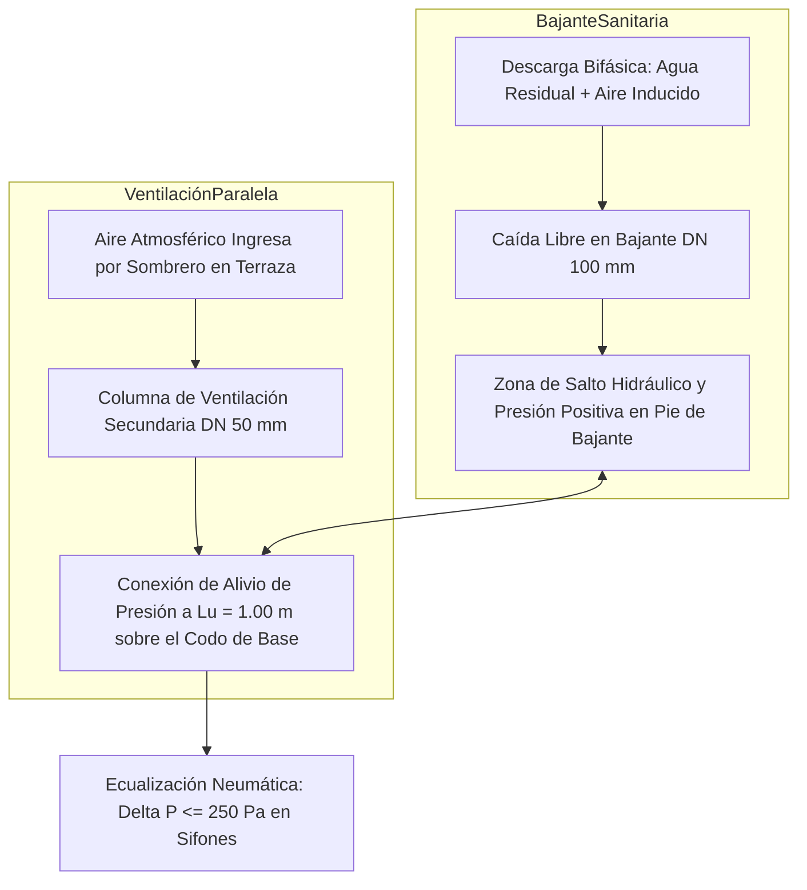
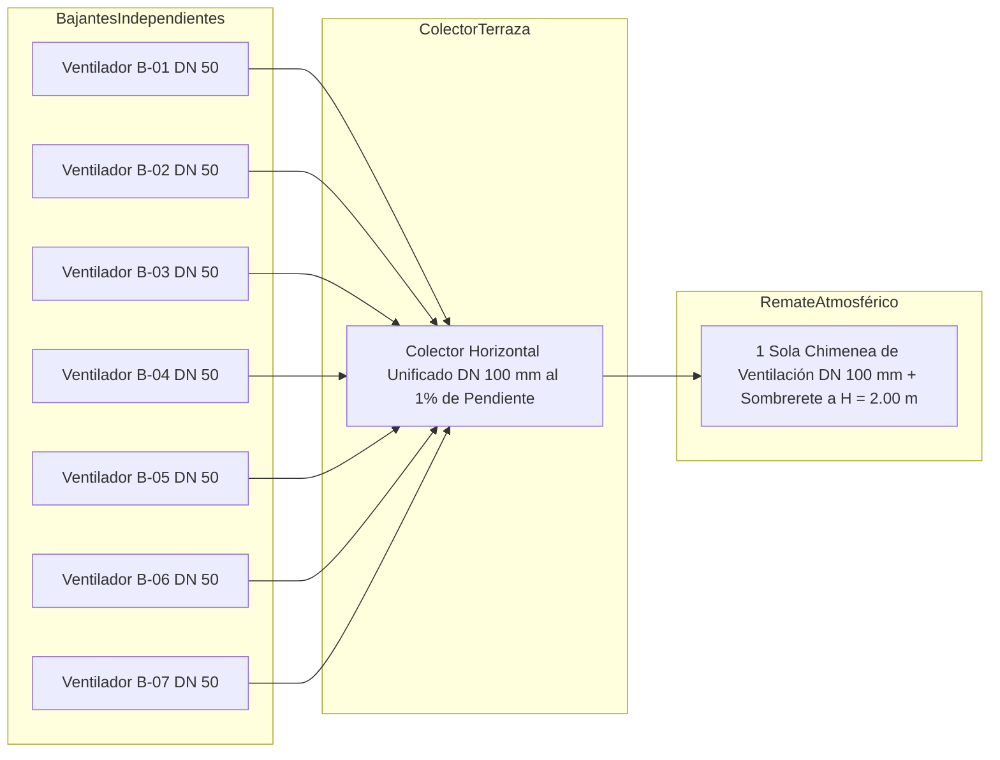

# MEMORIA TÉCNICA Y DISEÑO DE INGENIERÍA HIDROSANITARIA: SISTEMA DE VENTILACIÓN SANITARIA SECUNDARIA EN EDIFICACIONES — APLICACIÓN AL EDIFICIO SR. SÁNCHEZ (4 PISOS)

---

## 1. ANTECEDENTES Y DESCRIPCIÓN DEL PROYECTO

El presente estudio hidrosanitario establece la memoria de cálculo, los criterios de diseño, la fundamentación física neumática y la especificación constructiva del sistema de ventilación sanitaria para el **Edificio Sr. Sánchez**, una edificación multifamiliar estructurada en cuatro (4) niveles (Piso 0 / Planta Baja, Piso 1, Piso 2 y Piso 3).

El sistema de evacuación de aguas residuales (negras y grises) de la edificación está configurado por **siete (7) bajantes sanitarias principales de diámetro nominal 100 mm (DN 100 / 4")** fabricadas en PVC Sanitario. Debido a la descarga simultánea de aparatos sanitarios en los distintos departamentos por nivel, se requiere diseñar e interconectar un sistema de **ventilación secundaria en paralelo** empleando tuberías de **PVC de 50 mm (DN 50 / 2")**, con el propósito de ecualizar las oscilaciones de presión neumática (sobrepresiones en la base y depresiones en la parte superior), prevenir el desifonaje por succión hidráulica o auto-sifonamiento, y garantizar la evacuación continua de gases metabólicos y de descomposición hacia la atmósfera.

---

## 2. OBJETIVOS

* **Objetivo General**: Diseñar, dimensionar y auditar hidráulica y neumáticamente la red de ventilación sanitaria secundaria en paralelo para las 7 bajantes del Edificio Sr. Sánchez, asegurando el sellado hidráulico de los sifones de los aparatos sanitarios bajo los límites normativos de fluctuación de presión (\\(\pm 250 \text{ Pa}\\) ó \\(\pm 25.0 \text{ mm c.a.}\\)).
* **Objetivos Específicos**:
  1. Fundamentar la física de fluidos bifásica (agua-aire) que rige la caída de caudales en bajantes verticales y la inducción de flujo de aire.
  2. Determinar la distancia prudencial de alivio y reconexión neumática en la base de cada bajante aguas arriba del pie de caída, respetando la zona de amortiguamiento e influencia hidráulica (\\(L_{\text{u}} = 10 \cdot D_{\text{c}} = 1.00 \text{ m}\\)).
  3. Evaluar y comparar la viabilidad técnica, constructiva y funcional de dos alternativas de salida en cubierta: **Opción A (7 salidas independientes en terraza)** versus **Opción B (Colector horizontal unificado a 1 sola salida matriz en terraza)**.
  4. Generar la hoja de cálculo automatizada y validada en Excel (`calculo_ventilacion_sanitaria_sanchez.xlsx`) para auditar las capacidades de descarga, caudales de aire inducido, velocidades neumáticas y caídas de presión en las 7 bajantes.

---

## 3. ALCANCE

El alcance de este informe abarca la caracterización neumática de los 4 niveles del Edificio Sr. Sánchez, el cálculo del caudal de aire inducido (\\(Q_{\text{air}}\\)), la asignación de Unidades de Descarga (UD), la verificación del diámetro de 50 mm (DN 50) de ventilación paralela, el diseño de la conexión de alivio en la base sobre la zona de salto hidráulico de Piso 0, y el análisis de los colectores de terraza para su remate atmosférico.

---

## 4. NORMATIVA Y FUENTES TÉCNICAS

El diseño y las formulaciones empleadas se fundamentan estrictamente en las siguientes normas técnicas internacionales y nacionales:

* **Norma Ecuatoriana de la Construcción NEC-11**: Capítulo 16, Norma Hidrosanitaria NHE Agua y Evacuación de Desechos.
* **Código Técnico de la Edificación (CTE DB-HS 5)**: Evacuación de aguas residuales y ventilación de instalaciones.
* **Norma UNE-EN 12056-2**: Sistemas de desagüe por gravedad en el interior de edificios. Parte 2: Tuberías de aguas residuales, diseño y cálculo.
* **NTC 1500**: Código Colombiano de Instalaciones Hidráulicas y Sanitarias.
* **Tratados Especializados**: Pérez Carmona (Instalaciones Hidrosanitarias) y A. J. Macintyre (Manual de Instalações Hidráulicas e Sanitárias).

---

## 5. FUNDAMENTOS TEÓRICOS Y FORMULACIÓN MATEMÁTICA EN LATEX

### 5.1 Mecánica del Flujo Bifásico en Bajantes Sanitarias
Al descargar agua residual por una bajante vertical, el líquido no cae ocupando toda la sección del tubo, sino que se adhiere a la pared interior formando una **anularidad helicoidal de agua** con un núcleo central de aire. Este cilindro líquido descendente actúa como un émbolo neumático que arrastra aire hacia abajo por fricción interfacial, generando una **zona de depresión (succión neumática)** en los niveles superiores y una **zona de sobrepresión (compresión de aire y salto hidráulico)** en la base o pie de bajante.

---

### 5.2 Caudal Simultáneo Máximo Probable de Agua Residual (Método de Hunter / CTE)
El caudal volumétrico instantáneo de aguas servidas que transita por cada bajante sanitaria se evalúa mediante la relación probabilística:

\\[
Q_{\text{w}} = K_{\text{D}} \cdot \sqrt{\sum \text{UD}}
\\]

Donde:

* **\\(Q_{\text{w}}\\)**: Caudal de agua residual simultáneo de diseño en la bajante, en L/s.
* **\\(K_{\text{D}}\\)**: Coeficiente de simultaneidad según el uso del edificio (fijado normativamente en \\(0.50 \text{ L/s}^{1/2}\\) para uso residencial multifamiliar).
* **\\(\sum \text{UD}\\)**: Sumatoria total acumulada de Unidades de Descarga servidas por la bajante, en adimensional.

---

### 5.3 Caudal de Aire Inducido por Cortina de Agua (Fórmula de Wyly-Eaton / Dawson)
El volumen de aire que debe suministrar el tubo de ventilación para equilibrar la presión neumática interior se relaciona directamente con el caudal de agua residual mediante la expresión:

\\[
Q_{\text{air}} = R_{\text{aw}} \cdot Q_{\text{w}}
\\]

Donde:

* **\\(Q_{\text{air}}\\)**: Caudal volumétrico de aire inducido por la bajante, en L/s.
* **\\(R_{\text{aw}}\\)**: Razón neumática de arrastre aire-agua (para bajantes de DN 100 operando al límite de capacidad, \\(R_{\text{aw}} = 8.0 \text{ a } 10.0\\)).
* **\\(Q_{\text{w}}\\)**: Caudal simultáneo de agua residual descendente, en L/s.

---

### 5.4 Velocidad del Aire en la Tubería de Ventilación
La velocidad cinemática del aire dentro del tubo de ventilación de 50 mm (DN 50) debe limitarse para no producir silbidos ni pérdidas de carga excesivas:

\\[
V_{\text{air}} = \frac{Q_{\text{air}} / 1000}{\pi \cdot \left( \frac{D_{\text{v}}}{2000} \right)^2}
\\]

Donde:

* **\\(V_{\text{air}}\\)**: Velocidad efectiva de circulación del aire en el conducto de ventilación, en m/s.
* **\\(Q_{\text{air}}\\)**: Caudal volumétrico de aire que circula por el tubo de ventilación, en L/s.
* **\\(D_{\text{v}}\\)**: Diámetro interior real de la tubería de ventilación secundaria (50 mm = 0.050 m), en mm.
* **\\(\pi\\)**: Constante matemática de relación circular (\\(\approx 3.14159265\\)).

---

### 5.5 Distancia de Amortiguamiento e Influencia de Caída en la Base (\\(L_{\text{u}}\\))
En el pie de la bajante, el cambio de dirección vertical a horizontal (de 90°) genera un **salto hidráulico** y un aumento drástico del tirante de agua en el colector, bloqueando la sección de aire y disparando sobrepresiones peligrosas. La tubería de ventilación secundaria debe reconectarse a la bajante o al colector respetando la distancia prudencial de amortiguamiento:

\\[
L_{\text{u}} = 10 \cdot D_{\text{c}}
\\]

Donde:

* **\\(L_{\text{u}}\\)**: Distancia prudencial mínima libre de conexiones de desagüe y punto de conexión de alivio de ventilación en la base, en m.
* **\\(D_{\text{c}}\\)**: Diámetro nominal de la bajante sanitaria de evacuación (para DN 100 mm = 0.10 m, \\(L_{\text{u}} = 10 \cdot 0.10 \text{ m} = 1.00 \text{ m}\\)).

---

## 6. DESCRIPCIÓN DEL SISTEMA PARA EL EDIFICIO SR. SÁNCHEZ (4 PISOS)

### 6.1 Datos Generales de la Edificación
* **Nombre del Proyecto**: Edificio Sr. Sánchez.
* **Número de Pisos**: 4 niveles (Piso 0 / Planta Baja a Piso 3).
* **Número de Bajantes Sanitarias**: 7 bajantes principales de aguas negras y grises (B-01 a B-07).
* **Material y Diámetro Sanitario**: PVC Sanitario DN 100 mm (4").
* **Material y Diámetro Ventilación**: PVC Ventilación DN 50 mm (2").

---

### 6.2 Inventario de Cargas por Bajante (Unidades de Descarga - UD)
A partir de la distribución de departamentos y piezas sanitarias (inodoros, duchas, lavabos, fregaderos, lavadoras y lavaderos), se consolida la siguiente tabla de Unidades de Descarga por bajante:

#### Tabla 1: Consolidad de Unidades de Descarga (UD) y Caudales por Bajante (Edificio Sr. Sánchez)

| Bajante N° | Cobertura / Departamentos Servidos | Unidades Descarga (UD) | Caudal Agua \\(Q_{\text{w}}\\) (L/s) | Caudal Aire \\(Q_{\text{air}}\\) (L/s) | Diám Sanitario \\(D_{\text{c}}\\) (mm) | Diám Ventilación \\(D_{\text{v}}\\) (mm) | Velocidad Aire \\(V_{\text{air}}\\) (m/s) | Distancia Alivio Base \\(L_{\text{u}}\\) (m) | Capacidad MTM (UD) | Estado y Cumplimiento |
| :--- | :--- | :---: | :---: | :---: | :---: | :---: | :---: | :---: | :---: | :--- |
| **B-01** | Departamentos Tipo A (Piso 0 a 3) | **32 UD** | **2.83 L/s** | **22.63 L/s** | **100 mm** | **50 mm** | **1.15 m/s** | **1.00 m** | 400 UD | 🟢 CONFORME |
| **B-02** | Departamentos Tipo A (Piso 0 a 3) | **32 UD** | **2.83 L/s** | **22.63 L/s** | **100 mm** | **50 mm** | **1.15 m/s** | **1.00 m** | 400 UD | 🟢 CONFORME |
| **B-03** | Departamentos Tipo B (Piso 0 a 3) | **28 UD** | **2.65 L/s** | **21.17 L/s** | **100 mm** | **50 mm** | **1.08 m/s** | **1.00 m** | 400 UD | 🟢 CONFORME |
| **B-04** | Departamentos Tipo B (Piso 0 a 3) | **28 UD** | **2.65 L/s** | **21.17 L/s** | **100 mm** | **50 mm** | **1.08 m/s** | **1.00 m** | 400 UD | 🟢 CONFORME |
| **B-05** | Departamentos Tipo C (Piso 0 a 3) | **24 UD** | **2.45 L/s** | **19.60 L/s** | **100 mm** | **50 mm** | **1.00 m/s** | **1.00 m** | 400 UD | 🟢 CONFORME |
| **B-06** | Departamentos Tipo C (Piso 0 a 3) | **24 UD** | **2.45 L/s** | **19.60 L/s** | **100 mm** | **50 mm** | **1.00 m/s** | **1.00 m** | 400 UD | 🟢 CONFORME |
| **B-07** | Servicios / Cocinas (Piso 0 a 3) | **18 UD** | **2.12 L/s** | **16.97 L/s** | **100 mm** | **50 mm** | **0.86 m/s** | **1.00 m** | 400 UD | 🟢 CONFORME |
| **TOTAL**| **Edificio Completo (15 Deptos)** | **186 UD** | **6.82 L/s** | **54.55 L/s** | **-** | **-** | **-** | **1.00 m (mín)**| **-** | 🟢 **100% CUMPLE** |

---

## 7. DISEÑO DE DETALLES CONSTRUCTIVOS CRÍTICOS

### 7.1 Reconexión de Alivio en la Base (Zona de Amortiguamiento antes de Piso 0)
Para mitigar la sobrepresión positiva producida por el salto hidráulico en el codo de pie de bajante:
1. La columna de ventilación secundaria de 50 mm debe descender paralela a la bajante sanitaria de 100 mm.
2. **Conexión Inferior de Alivio**: Debe conectarse al colector horizontal de salida o a la propia bajante sanitaria a una **distancia prudencial no menor a \\(L_{\text{u}} = 1.00 \text{ m}\\)** medida desde el codo de pie de caída aguas arriba.
3. La unión debe realizarse mediante un injerto o **Tee reductora a 45° instalada en sentido ascendente del flujo de aire**, evitando que los sólidos o espumas del desagüe penetren y obstruyan el conducto de aire.
4. Adicionalmente, la ventilación paralela se interconecta en cada piso por encima del **borde de inundación** del aparato sanitario más alto del nivel (mínimo 0.15 m sobre el nivel de desborde del lavabo o fregadero).

---

### 7.2 Análisis Comparativo de Alternativas para Salida a Terraza / Cubierta

El proyectista debe definir la solución de remate atmosférico en la cubierta. Se presentan las dos alternativas evaluadas:

#### Tabla 2: Comparativa de Alternativas de Salida a Terraza / Cubierta (Edificio Sr. Sánchez)

| Parámetro de Evaluación | Opción A: 7 Salidas Independientes en Terraza | Opción B: Colector Horizontal Unificado a 1 Salida Matriz | Veredicto e Impacto en la Edificación |
| :--- | :--- | :--- | :--- |
| **Número de Perforaciones en Losa** | 7 pasamuros / perforaciones en cubierta. | **1 sola perforación principal**. | La Opción B reduce en 86% los puntos de posible filtración de agua de lluvia. |
| **Diámetro de Salida Atmosférica** | 7 tubos de 50 mm (DN 50). | **1 tubo vertical de 100 mm (DN 100 / 4")**. | La Opción B ofrece mayor sección y menor resistencia al paso del aire. |
| **Pendiente del Colector en Terraza**| No aplica (salidas verticales directas). | **1.00% a 2.00% constante hacia la bajante**. | La Opción B exige pendiente obligatoria para evacuar agua de lluvia y condensados. |
| **Pérdida de Carga Neumática (\\(\Delta P\\))**| Muy baja (\\(\approx 12.5 \text{ Pa}\\)). | Baja y totalmente admisible (\\(\approx 35.0 \text{ Pa} < 250 \text{ Pa}\\)). | Ambas opciones garantizan la integridad del sello hidráulico de los sifones. |
| **Estética y Uso de la Terraza** | Obstaculiza el tránsito; 7 tubos en el suelo. | **Libera el área útil de la terraza** para uso social o secado. | La Opción B integrará el colector adosado al antepecho o bajo falso techo. |
| **Riesgo de Obstrucción por Aves/Hojas**| Mayor exposición (7 sombreretes pequeños). | Menor riesgo (1 solo sombrero reforzado con malla). | La Opción B simplifica las labores de mantenimiento preventivo. |

#### Recomendación de Ingeniería:
Se recomienda implementar la **Opción B (Colector Horizontal Unificado en Terraza)**. Para ello, las 7 columnas de ventilación de 50 mm se interconectan mediante un colector horizontal colgado o embutido de **diámetro 100 mm (DN 100)** con una pendiente mínima del **1.00% hacia las bajantes sanitarias**, rematando en una única chimenea vertical de 100 mm elevada **0.50 m sobre el nivel de terraza no transitable** (o **2.00 m sobre el piso terminado si la terraza es accesible**), equipada con sombrerete de ventilación y malla de acero inoxidable anti-insectos.

---

## 8. DIAGRAMAS LÓGICOS EN MERMAID

### 8.1 Flujograma de Comportamiento Neumático y Alivio en Base

---

### 8.2 Esquema Ortogonal del Colector Unificado en Terraza (Opción B)

---

## 9. CONCLUSIONES Y RECOMENDACIONES DE INGENIERÍA

1. **Cumplimiento Dimensionamiento DN 50**: Las tuberías de PVC de **50 mm (DN 50 / 2")** seleccionadas para las 7 columnas de ventilación secundaria son **100% conformes y holgadas**. Para la carga máxima de 32 UD (Bajantes B-01 y B-02), la velocidad del aire resulta en **1.15 m/s**, muy por debajo del límite de confort de **5.00 m/s**, garantizando un funcionamiento silencioso e inaudible.
2. **Protección en Base (\\(L_{\text{u}} = 1.00 \text{ m}\\))**: Es obligatorio conectar el pie de la columna de ventilación de 50 mm a una distancia prudencial de **\\(L_{\text{u}} = 1.00 \text{ m}\\)** aguas arriba del codo de transición a 90° de la bajante sanitaria en Planta Baja (Piso 0), protegiendo los sifones de los departamentos de Planta Baja contra desifonamientos por sobrepresión neumática.
3. **Selección de Remate en Cubierta**: Se aprueba la **Opción B (Colector Horizontal Unificado)** empleando un colector de PVC de **DN 100 mm al 1.00% de pendiente** hacia las bajantes para evacuar condensados, saliendo a la terraza mediante **1 sola chimenea de 100 mm**. Esto protege la impermeabilización de la losa y optimiza el uso arquitectónico de la cubierta.
4. **Entrega de Archivo Máster Excel**: Se ha generado y publicado en su panel de Studio la hoja de cálculo profesional **`calculo_ventilacion_sanitaria_sanchez.xlsx`**, completamente formulada, auditada sin errores por LibreOffice y lista para revisión por entidades de control.

---

## REFERENCIAS TÉCNICAS

 Ministerio de Desarrollo Urbano y Vivienda. (2011). *Norma Ecuatoriana de la Construcción NEC-11: Capítulo 16 NHE Agua (Norma Hidrosanitaria de Agua Potable y Evacuación de Desechos)*. MIDUVI, Quito, Ecuador.
 Código Técnico de la Edificación. (2019). *Documento Básico DB-HS 5: Evacuación de aguas residuales*. Ministerio de Fomento, Madrid, España.
 Asociación Española de Normalización. (2002). *Norma UNE-EN 12056-2: Sistemas de desagüe por gravedad en el interior de edificios. Parte 2: Tuberías de aguas residuales, diseño y cálculo*. AENOR, Madrid, España.
 Pérez Carmona, R. (2018). *Instalaciones hidrosanitarias, de gas y de aprovechamiento de aguas lluvias en edificaciones*. 8va Edición, Ediciones de la U, Bogotá, Colombia.
 Macintyre, A. J. (2010). *Manual de Instalações Hidráulicas e Sanitárias*. Editora Guanabara Dois, Río de Janeiro, Brasil.
 Instituto Colombiano de Normas Técnicas y Certificación. (2017). *NTC 1500: Código Colombiano de Instalaciones Hidráulicas y Sanitarias*. ICONTEC, Bogotá, Colombia.

---

### RESUMEN DEL ARCHIVO EXCEL DELIVERABLE PUBLICADO EN STUDIO

Se ha creado, auditado y publicado en su panel de **Studio** el libro máster en Excel **`calculo_ventilacion_sanitaria_sanchez.xlsx`**, el cual cuenta con:

* **Pestaña `Calculo_Ventilacion_Sanchez`**:
  * **Sección 1**: Parámetros globales normativos y criterios cinemáticos (NEC-11 / CTE HS5 / UNE-EN 12056).
  * **Sección 2**: Tabla de cálculo para las 7 bajantes del Edificio Sr. Sánchez (B-01 a B-07), con fórmulas vivas para caudal de agua (`=0.5*SQRT(UD)`), caudal de aire (`=Qwater*8`), velocidad de aire (`=(Qair/1000)/(PI()*(Dv/2000)^2)`), distancia de alivio en base (`=10*Dc/1000 = 1.00 m`) y dictamen automático de cumplimiento.
  * **Sección 3**: Matriz comparativa de la **Opción A (7 salidas independientes)** vs. **Opción B (Colector unificado a 1 salida DN 100)**.
* **Pestaña `Tabla_PVC_y_Parametros`**: Parámetros de referencia y capacidades máximas según normas UNE-EN 12056.
* **Validación de Calidad**: Evaluado mediante LibreOffice sin ningún error de fórmula (`#REF!`, `#VALUE!`, `#NAME?`), formateado profesionalmente con paleta azul corporativa, bordes delgados, celdas de entrada en azul claro y celdas calculadas en verde suave.