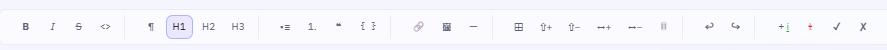

# PROMPT DE INGENIERÍA — CORRECCIÓN DE CARGA .MD, PANEL LATERAL DE CONVERSIÓN RETRÁCTIL Y VISORES DEDICADOS (WORD, PDF, HTML Y EXCEL) EN "MARKFLOW AI"

## 1. Rol y Contexto Técnico

Actúa como un **Arquitecto de Software Senior Full-Stack experto en interfaces web interactivas (Streamlit / Python / JavaScript), gestión de estados de archivos y motores de conversión y previsualización documental**.

Debemos solucionar un error crítico en la carga de archivos Markdown dentro de la pestaña documentos, rediseñar el flujo de exportación incorporando un **panel lateral retráctil multifunción**, y habilitar **visores y previsualizaciones dedicadas** para cada formato de salida (Word, PDF, HTML y Tablas estilo Excel). word y pdf ya existen pero hay que corregirlas para q cumplan especificaciones

---

## 2. Especificaciones Técnicas de Implementación

### REQUISITO 1: Corrección de Carga de Archivos `.md` en Plantillas y Placeholders

- **Problema actual:** En la pestaña *"Plantillas y Placeholders Dinámicos"*, el sistema no permite cargar ni procesar correctamente archivos con extensión `.md`.
- **Solución obligatoria:**
  1. Actualiza el componente de carga (`st.file_uploader` o equivalente) para que acepte explícitamente el tipo de archivo `['md', 'markdown', 'txt']`.
  2. Asegura que el contenido del archivo `.md` cargado se lea correctamente como texto UTF-8 y se inyecte en el estado activo del editor de plantillas sin generar excepciones de tipo.

---

### REQUISITO 2: Indicador Visual de Modo Fuente en la Pestaña "Docs"

- **Funcionalidad requerida:**
  1. En la pestaña *"Docs"*, cuando el usuario cargue o seleccione una fuente de datos, el botón de fuente debe **cambiar de color de manera dinámica** (ej. pasar de gris neutro a un tono verde éxito o azul activo) para indicar visualmente que el sistema se encuentra actualmente en *"Modo Fuente Activo"*.
  2. tambien es necesario hacer mas visible (o un poco mas grande) el menu de iconos superior  
      

y tambien activar un icono para embeber **notas** en un parrafo señalado ya sea en modo codigo como en renderizado

### REQUISITO 3: Panel Lateral Retráctil de Conversión Completa en pestaña docs

- **Funcionalidad requerida:**
  1. Ubica a la derecha de la interfaz un **panel vertical oculto/retráctil** que se active mediante un icono flotante o botón sutil.
  2. Al abrirse, este panel debe desplegar **todas las opciones de conversión avanzadas** de la pestaña de conversión completa (selección de formatos de salida, paletas de colores, temas, tipografías, opciones de interlineado y configuraciones para HTML, MD, PDF , excel y Word).
  3. Desde alli puedes redirigir cada exportacion a su pestaña dedicada dentro de la app (peticion mas adelante) o descrgarlas directamente
  4. **Centralización del flujo de exportación:** Reemplaza o repara el botón tradicional de *"Exportar a Word"* (que actualmente genera un archivo en blanco por problemas de contexto de sesión) y maneja todas las generaciones y descargas directamente desde este panel lateral unificado.

---

### REQUISITO 4: Vistas y Pestañas de Previsualización Dedicadas por Formato

Implementa pestañas o secciones de previsualización independientes y especializadas para cada formato de salida:

1. **Vista / Pestaña Word (.docx):** Un área dedicada donde se pueda verificar o renderizar la estructura del documento Word antes de su descarga definitiva. ya existe esta pestaña solamente debes corregirla opara los fines requeridos, ademas debes activar la pestaña de descarga desde esta pestaña 
2. **Vista / Pestaña PDF:** Una pestaña vertical dedicada que incruste un visor PDF funcional para inspeccionar el documento ya maquetado con CSS Paged Media. ya existe esta pestaña solamente debes corregirla opara los fines requeridos, ademas debes activar la pestaña de descarga desde esta pestaña, aqui debemos tambien colocar un boton d eliminar los pdfs que ya no se requieran
3. **Vista / Pestaña HTML:** Una pestaña vertical dedicada que renderice el código HTML con su sidebar y estilos definitivos en tiempo real., no existe hay que coinstruirla
4. **Vista / Pestaña Excel (Tablas Estilo Hoja de Cálculo):**
   - Si el documento contiene tablas, el sistema debe extraerlas y renderizarlas en una pestaña dedicada simulando una **interfaz de hoja de cálculo de Excel** (con filas y columnas malladas).
   - Incluye un botón flotante de **"Copiar Tabla"** para que el usuario pueda copiar los datos tabulares al portapapeles con un solo clic en formato compatible con Excel.
   - no existe hay que coinstruirla

---

# CHECKLIST DE VERIFICACIÓN Y VALIDACIÓN — MEJORAS DE MARKFLOW 

---

## 1. Corrección de Carga de Archivos `.md`

- [ ] **Soporte de Extensiones:** Actualizar el componente `st.file_uploader` (o equivalente) en la pestaña *"Plantillas y Placeholders Dinámicos"* para aceptar explícitamente los formatos `['md', 'markdown', 'txt']`.
- [ ] **Decodificación UTF-8:** Asegurar que el contenido del archivo `.md` cargado se lea correctamente en formato de texto UTF-8.
- [ ] **Inyección de Estado:** Validar que el texto leído se inyecte exitosamente en el estado activo del editor de plantillas sin generar excepciones de tipo.

---

## 2. Indicador Visual de Modo Fuente y Menús en la Pestaña "Docs"

- [ ] **Botón de Fuente Activa:** Programar el cambio de color dinámico del botón de fuente en la pestaña *"Docs"* al estar activo (ej. transición de gris neutro a azul/verde). tener cuidado en modo oscuro, revisar tambien
- [ ] **Visibilidad del Menú Superior:** Aumentar el tamaño y espaciado de la barra de iconos superior para mejorar la accesibilidad visual.
- [ ] **Inserción de Notas:** Activar y programar el icono para embeber marcas de **notas** (`>`) de manera inmediata en el párrafo seleccionado, tanto en modo código como en la pantalla renderizada.

---

## 3. Panel Lateral Retráctil de Conversión Completa

- [ ] **Estructura Retráctil:** Diseñar e implementar el panel vertical oculto en el margen derecho de la pestaña *"Docs"*, activable mediante un icono flotante o botón sutil.
- [ ] **Opciones Avanzadas:** Integrar dentro del panel todas las opciones de conversión (formatos de salida, paletas de colores sobrias, temas, tipografías e interlineado).
- [ ] **Centralización de Exportaciones:** Reparar el flujo de exportación a Word (eliminando el error de archivos en blanco) y unificar la gestión de todas las generaciones y descargas directamente desde este panel retráctil.

---

## 4. Vistas y Pestañas de Previsualización Dedicadas por Formato

### 4.1. Pestaña Word (`.docx`)

- [ ] Corregir la lógica de renderizado/previsualización existente para verificar la estructura del documento Word.
- [ ] Habilitar y activar el botón de descarga directa del archivo `.docx` dentro de su propia pestaña dedicada.

### 4.2. Pestaña PDF (`.pdf`)

- [ ] Estabilizar el visor PDF vertical existente con CSS Paged Media.
- [ ] Habilitar el botón de descarga directa del PDF desde la pestaña dedicada.
- [ ] Implementar un **botón de eliminación** para limpiar y borrar archivos PDF temporales o que ya no se requieran en el sistema.

### 4.3. Pestaña HTML (`.html`) — *Nuevo componente*

- [ ] Construir la pestaña vertical dedicada para HTML.
- [ ] Configurar el renderizado en tiempo real con el sidebar fijo a la izquierda y los estilos definitivos de la paleta activa.

### 4.4. Pestaña Excel / Tablas Tabulares — *Nuevo componente*

- [ ] Desarrollar la lógica de extracción automática de todas las tablas presentes en el documento.
- [ ] Renderizar las tablas en una interfaz interactiva simulando una hoja de cálculo (con cuadrícula mallada de filas y columnas).
- [ ] Incluir el botón flotante de **"Copiar Tabla"** para transferir los datos al portapapeles en un formato compatible con Excel con un solo clic.

---

## 5. Criterios de Aceptación General

- [ ] Todas las pestañas y visores dedicados responden de manera fluida y sin latencia.
- [ ] La interfaz mantiene la coherencia visual con el sistema de diseño corporativo y las paletas ejecutivas.
- [ ] No existen bloqueos de sesión ni archivos vacíos al utilizar el panel lateral unificado de exportación.

&nbsp;