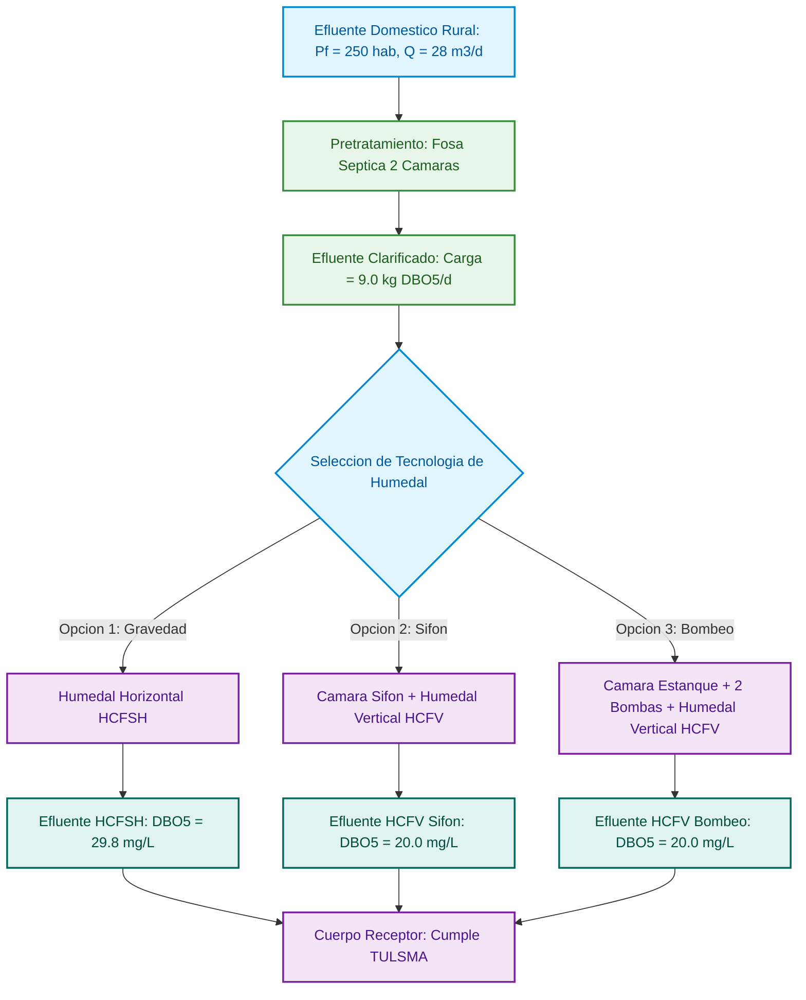

# Prompt de Corrección por Fases — MarkFlow Office (Docs, Word, PDF, HTML)

Oct 28, 2026 · @Patto

Prompt técnico listo para copiar en la IA de desarrollo (Antigravity): corrige por fases los 4 defectos reportados — renderizado roto en Docs y HTML, desincronización previsualización↔exportación en Word (temas, paletas, alineación) y zoom/saltos de página incorrectos en PDF — sin avanzar de fase sin evidencia real y confirmación del usuario.

## 0. Diagnóstico de causa raíz y reglas generales

El `historial_de_versiones.md` registra que el salto de capítulo H1-only y el zoom del PDF ya se "corrigieron" en v1.17.4, v1.20.0 y v1.20.1, pero ambos defectos siguen presentes hoy. Eso indica que los reportes anteriores no se verificaron con evidencia real, y que se están parchando síntomas en lugar de la causa.

**Causa raíz más probable (verificar antes de tocar código):** Docs, Word, PDF y HTML probablemente usan funciones de renderizado Markdown/Mermaid distintas para "previsualización" y para "exportación", en vez de una sola función compartida. Revisa cuántas funciones generan HTML a partir del Markdown en `static/js/office.js` (`renderizarMermaidCompartido`, `renderizarHojaWordPreview`, `cargarVisorHtmlDedicado`) y si realmente invocan el mismo compilador que usan `motor/a_html.py`, `motor/a_docx.py` y `motor/a_pdf.py` en el backend.

Evidencia directa: el panel de Docs y el de HTML muestran hoy texto crudo sin renderizar, por ejemplo `<1 id="memoria-t-cnica...">MEMORIA TÉCNICA DE INGENIERÍA HIDRÁULICA...` en vez de un `<h1>` en negrita. Esto confirma que el HTML generado se inserta como texto escapado (o que el compilador deja marcadores internos sin resolver) en el panel de previsualización.

### Reglas generales (aplican a las 4 fases)

1. **Analiza antes de tocar código.** Cita archivo y función reales responsables antes de escribir una línea. Si una función esperada no existe, dilo en el reporte.
2. **Un solo renderizador por elemento, de verdad.** Encabezados, negritas, Mermaid, KaTeX e imágenes deben pasar por una única función Markdown→HTML compartida entre Docs, Word, PDF y HTML (previsualización y exportación). Esta es la corrección más importante del documento: sin ella, cualquier otra corrección se desincroniza de nuevo.
3. **No rompas lo que funciona:** ingesta de archivos, el .docx que hoy sí trae negritas y Mermaid correctos, fórmulas KaTeX, numeración, firma e índice final, el store de Documentos, el visor flotante.
4. **Sin CDNs.** Todo offline; librería nueva = pedir aprobación antes de instalar.
5. **Prohibido fabricar reportes de "completado".** Cada criterio de aceptación se demuestra con captura de pantalla real, el archivo exportado abierto, o el output real de una prueba ejecutada en ese momento. Sin evidencia, el punto se reporta como pendiente.
6. **Una fase a la vez.** No se avanza sin entregar el reporte de la fase (formato al final de este documento) y sin confirmación explícita del usuario.
7. **Idioma:** español en toda la interfaz y los mensajes.
8. **Rutas de temas reales.** Los temas de Word y HTML deben leerse siempre desde `D:\APPS\Apps_2026\3_App_convertir_MARKFLOW_office\templates\word` y `...\templates\html`. Ningún tema "por defecto" embebido en el código puede sustituir a estos archivos.

## FASE 1 — Pestaña Docs: renderizado en vivo de negritas, jerarquía de títulos y Mermaid

### 1.1 Problema observado

- El panel derecho de Docs (previsualización) no muestra los encabezados en negrita ni con el tamaño correspondiente a su nivel (H1/H2/H3).
- Los diagramas Mermaid no se renderizan a imagen/SVG en la previsualización; el bloque `mermaid` queda sin transformar.
- Evidencia capturada: el panel muestra literalmente `<1 id="memoria-t-cnica-de-ingenier-a-hidr-ulica...">MEMORIA TÉCNICA DE INGENIERÍA HIDRÁULICA...` en vez de un encabezado real. Esto sugiere marcadores internos sin resolver, o inserción del resultado como texto escapado en el DOM.

### 1.2 Diagnóstico obligatorio antes de corregir

- Localiza la función (archivo y nombre) que genera el HTML del panel derecho de Docs. Indica si es la misma que usa `motor/a_html.py` para exportar `.html`, o una función JS independiente (candidatos: `static/js/editor_docs.js`, `static/js/office.js`).
- Localiza la función que debería renderizar Mermaid en ese panel (candidata: `renderizarMermaidCompartido` en `static/js/office.js`). Comprueba si se invoca al montar/actualizar el panel de Docs.
- Determina por qué aparecen los marcadores `<N id="...">` sin convertir: tokens internos sin resolver, inserción con `textContent` en vez de `innerHTML`, o doble escape de HTML.

### 1.3 Requisitos de corrección

- El panel debe renderizar el documento como se vería en una exportación HTML simple: jerarquía H1/H2/H3, **negrita**/*cursiva*, listas, tablas y fórmulas KaTeX.
- Los bloques `mermaid` se compilan a SVG/imagen en vivo con la misma función que usan las demás pestañas (Regla general 2). Error de sintaxis → mensaje amigable en español, nunca el bloque crudo ni una "bomba" de error.
- Previsualización en vivo con debounce (\~300 ms) al editar, sin cambiar de pestaña.
- Prohibido cualquier marcador interno (`<N id="...">`, tokens `@@...@@`, `MERMTOKEN`) visible como texto.

### 1.4 Verificación obligatoria

- Pega el diagrama del Anexo A y confirma por captura que se ve como imagen, no como texto ni bloque de código.
- Documento de prueba con H1/H2/H3 y **negrita**: captura confirmando jerarquía visual correcta.
- Consola del navegador sin errores relacionados a Mermaid o al renderizador.

### 1.5 Criterios de aceptación (Fase 1)

- [ ] H1/H2/H3 con jerarquía y negrita correctas en la previsualización de Docs.
- [ ] **Negrita**/*cursiva* renderizadas correctamente.
- [ ] El diagrama del Anexo A se renderiza como imagen/SVG legible.
- [ ] Ningún marcador interno visible como texto.
- [ ] Previsualización en vivo al editar.
- [ ] La función de renderizado de Docs es la misma (o llama a la misma) que usan Word, PDF y HTML — documentada por nombre y ubicación en el reporte.

## FASE 2 — Pestaña Word: paridad previsualización↔exportación, temas reales, paletas y alineación

### 2.1 Problemas observados

- La previsualización de Word tiene el mismo defecto que Docs (sin negritas, sin Mermaid), pero el .docx exportado sí muestra títulos en negrita y Mermaid correcto: previsualización y exportación usan rutas de código distintas.
- El panel lateral ofrece Tema 1/2/3, pero sin importar cuál se seleccione se aplica un tema hardcodeado llamado "Estilo Formal", que no existe en la carpeta real de temas.
- Las paletas personalizadas del usuario no se reflejan ni en previsualización ni en el .docx.
- La alineación de texto (justificado, centrado, etc.) no funciona en ninguno de los dos.

### 2.2 Diagnóstico obligatorio antes de corregir

- Lista los archivos reales en `D:\APPS\Apps_2026\3_App_convertir_MARKFLOW_office\templates\word` y `\html`, y compáralos con lo que ofrece hoy el selector de temas de Word. Busca si el código referencia esa ruta en `motor/a_docx.py` / `motor/registro_opciones.py`.
- Encuentra el origen de "Estilo Formal": ¿fallback hardcodeado cuando la ruta no se encuentra, o primer elemento de una lista que sustituyó la lectura real de archivos?
- Compara función por función la previsualización (candidata: `renderizarHojaWordPreview` en `static/js/office.js`) contra `motor/a_docx.py`: ¿comparten compilador Markdown, paleta/CSS y lógica de alineación? Documenta las diferencias antes de tocar nada.
- Revisa cómo se guarda/lee una paleta personalizada (candidato: `localStorage` vía `window.MFORegistro`) y si llega como parámetro tanto a la previsualización JS como al endpoint `/api/office/exportar-docx` en `app/rutas/office.py`.
- Revisa cómo se lee/aplica la alineación en ambos caminos.

### 2.3 Requisitos de corrección

**Paridad previsualización↔exportación (prioridad máxima):** la previsualización debe mostrar exactamente lo que se exportará — negritas, jerarquía, Mermaid, paleta, tipografía y alineación iguales. Unifica las rutas de código (Regla general 2) o haz que la previsualización consuma el mismo HTML intermedio que alimenta al generador de .docx.

**Temas reales desde disco:** Tema 1/2/3 (y cualquier otro nativo) deben leer su definición real desde `...\templates\word`. Ningún estilo hardcodeado puede sustituirlos. Si un tema no se encuentra, mostrar aviso claro ("Tema no encontrado en templates/word") en vez de aplicar silenciosamente un valor no solicitado.

**Paletas personalizadas:** una paleta creada por el usuario se aplica íntegramente en previsualización y en el .docx (color de H1/H2, cabecera/filas de tablas, bordes), igual que los temas nativos.

**Alineación de texto:** justificado/centrado/izquierda/derecha se aplican párrafo por párrafo en previsualización y en el .docx (mecanismo real `w:jc` de OpenXML en la exportación).

### 2.4 Verificación obligatoria

- Selecciona Tema 1, 2 y 3 uno por uno: captura de previsualización y del .docx exportado y abierto para cada uno, confirmando coincidencia entre sí y con los archivos reales de `templates\word`.
- Crea una paleta personalizada con colores distintivos y confirma por captura que aparece igual en previsualización y en el .docx.
- Activa "justificado" y confirma visualmente en previsualización y .docx abierto.
- Repite con el diagrama del Anexo A: Mermaid igual en previsualización y exportación.

### 2.5 Criterios de aceptación (Fase 2)

- [ ] Previsualización de Word = negritas, jerarquía y Mermaid iguales al .docx exportado.
- [ ] Temas Tema 1/2/3 leídos de `templates\word` (y HTML de `templates\html`), nunca de un valor hardcodeado tipo "Estilo Formal".
- [ ] Paletas personalizadas reflejadas en previsualización y exportación.
- [ ] Alineación de texto funcional en previsualización y exportación.
- [ ] Ninguna exportación previa (fórmulas, tablas anchas, firma, índice) se rompió.

## FASE 3 — Pestaña PDF: zoom tipo visor real, previsualización en vivo y salto de capítulo exclusivo a H1

### 3.1 Problemas observados

- El zoom no se comporta como un visor de PDF real: la hoja (canvas) mantiene tamaño fijo al aumentar el porcentaje, en vez de crecer y generar barras de desplazamiento.
- No hay soporte de Ctrl + rueda del ratón para zoom en tiempo real sobre el canvas principal.
- Los cambios de opciones del panel lateral no se reflejan de inmediato en la previsualización.
- Bug crítico: el check "Salto de capítulo (H1 en nueva página)" provoca salto también en H2 (2.1, 2.2…), cuando debe aplicarse solo a H1.
- Falta la excepción de primera hoja: cuando el documento inicia con título general + introducción breve antes del primer H1, ese primer H1 ("1.") no debe forzar salto; desde el segundo H1 en adelante sí debe saltar siempre.

### 3.2 Diagnóstico obligatorio antes de corregir

- Localiza en `motor/a_pdf.py` la regla/CSS que decide qué encabezados reciben salto de página (candidatos: `salto_capitulo_css`, reglas `page-break-before` sobre `h1`). Verifica si el selector distingue `h1` de `h2`/`h3`, o si se aplica a una clase genérica (`.capitulo-break`) que también se agrega a subtítulos — ahí estaría el defecto.
- Verifica si existe hoy alguna lógica de excepción para el primer `h1:first-of-type` y por qué no cubre el caso "título + introducción antes del primer H1".
- Localiza la función de render/zoom (candidata: `static/js/visor_pdf.js`, `renderPagina()`). Verifica si el zoom se implementa estirando el canvas con CSS (`transform: scale`) en vez de re-renderizar la página de pdf.js a la nueva escala real.
- Revisa si existe un listener de rueda con `Ctrl` sobre el canvas principal, y si el panel de miniaturas queda correctamente excluido de ese listener.

### 3.3 Requisitos de corrección

**Zoom real tipo visor de PDF:** al cambiar el zoom (botones +/−, selector, o Ctrl+rueda), la página se re-renderiza con pdf.js a la nueva escala (nunca CSS transform/scale), manteniendo el texto nítido. La hoja visible crece de tamaño real, con barras de desplazamiento cuando excede el área visible. Ctrl+rueda sobre el canvas principal cambia el zoom en tiempo real (paso \~10% por muesca, límites 25%–400%), bloqueando el zoom nativo del navegador (`preventDefault`) solo mientras el cursor está sobre el visor; sobre el panel de miniaturas, Ctrl+rueda NO debe afectar el zoom del PDF. El selector de porcentaje refleja el valor actual de inmediato. Los atajos Ctrl+"+", Ctrl+"−", Ctrl+0 funcionan solo cuando el visor tiene el foco.

**Previsualización en vivo:** cualquier cambio del panel lateral se refleja sin recarga manual, con retardo corto (\~300 ms) sin bloquear la interfaz.

**Salto de capítulo exclusivo a H1:** el salto se aplica únicamente a H1 (1., 2., 3.…); H2 y H3 nunca generan salto, sin importar el check. Excepción de primera hoja: si antes del primer H1 hay título general/introducción breve, esa parte y el primer H1 quedan en la misma hoja; desde el segundo H1 el salto siempre se aplica. Esta misma regla (H1-only + excepción de primera hoja) debe aplicarse de forma consistente en Word y HTML cuando exista la opción equivalente — un solo criterio para todas las exportaciones.

### 3.4 Verificación obligatoria

- Documento de prueba: título + introducción breve, "1. Primer capítulo" con 1.1/1.2, "2. Segundo capítulo" con 2.1, "3. Tercer capítulo". Exporta a PDF y confirma página por página (captura de cada hoja): introducción + "1." en la hoja 1; "2." inicia hoja nueva; los subtítulos nunca generan salto.
- Zoom al 200% y 300% con el selector: captura mostrando que la hoja creció y aparecen barras de desplazamiento.
- Zoom con Ctrl+rueda sobre el canvas principal: confirma en vivo que el porcentaje cambia y la hoja crece; confirma que sobre miniaturas no cambia el zoom del PDF.
- Cambia una opción del panel lateral (p. ej. paleta) y confirma actualización sin recarga manual.

### 3.5 Criterios de aceptación (Fase 3)

- [ ] El zoom re-renderiza la página con pdf.js a la nueva escala (no CSS scale), con texto nítido.
- [ ] La hoja crece de tamaño visible al aumentar el zoom y aparecen barras de desplazamiento cuando corresponde.
- [ ] Ctrl+rueda sobre el canvas principal cambia el zoom en tiempo real; sobre miniaturas no lo cambia.
- [ ] Controles +/−/selector/atajos funcionan y respetan el foco del visor.
- [ ] El salto de página se aplica solo a H1; H2 y H3 nunca saltan.
- [ ] La excepción de primera hoja funciona: introducción + primer H1 juntos; desde el segundo H1 sí hay salto.
- [ ] Los cambios del panel lateral se reflejan de inmediato en la previsualización.

## FASE 4 — Pestaña HTML: paridad con Docs, exportación limpia y respeto del panel lateral

### 4.1 Problemas observados

- Mismo defecto que Docs: en la previsualización de HTML no se ven los títulos en negrita ni el Mermaid renderizado. Evidencia capturada: el panel muestra literalmente `<1 id="...">MEMORIA TÉCNICA...`, `<2 id="...">1. MARCO CONCEPTUAL...`, en vez de encabezados HTML reales.
- El .html exportado se ve "muy desordenado" (detalle a precisar con un caso real durante el diagnóstico).
- El panel lateral (plantilla, paleta, diseño y lectura, encabezado y pie) no se refleja ni en previsualización ni en exportación.
- El texto no se justifica en la web exportada aunque se configure.

### 4.2 Diagnóstico obligatorio antes de corregir

- Confirma si la previsualización de HTML usa la MISMA función rota que Docs (muy probable, síntoma idéntico). Documenta explícitamente si al corregir la Fase 1 este problema desaparece aquí sin tocar código adicional, o si HTML tiene su propia ruta de renderizado rota por separado.
- Genera un documento de prueba, expórtalo a `.html` real, ábrelo en un navegador y documenta con capturas/inspección de código fuente qué es exactamente lo "desordenado" (¿CSS no se inyecta?, ¿plantilla no se aplica?, ¿Mermaid rompe el layout?).
- Verifica si la función/endpoint de exportación (`motor/a_html.py`, `POST /api/office/exportar-html`) recibe realmente los parámetros del panel lateral (plantilla, paleta, alineación) o los ignora.
- Verifica la lógica de alineación/justificado en `motor/a_html.py` (¿existe una regla `text-align: justify` condicionada a una opción que nunca llega?).

### 4.3 Requisitos de corrección

- La previsualización de HTML debe mostrar encabezados en negrita con jerarquía y Mermaid como SVG, siendo el espejo exacto de lo que se exportará (misma función compartida, Regla general 2).
- El `.html` exportado debe: aplicar la plantilla/tema seleccionado (de los temas reales en `...\templates\html`, ver Fase 2); aplicar la paleta (nativa o personalizada); respetar "Diseño y lectura"; respetar encabezado y pie configurados; aplicar justificación/alineación de texto; no mostrar scroll interno en diagramas, tablas ni imágenes (si reaparece, es una regresión ya certificada en v1.20.0/v1.20.1 — repórtala explícitamente).
- Prohibido cualquier marcador interno visible (`<N id="...">`, tokens sin resolver) tanto en previsualización como en el archivo exportado.

### 4.4 Verificación obligatoria

- Pega el diagrama del Anexo A y un documento con H1/H2/H3 y **negrita**: captura de la previsualización confirmando renderizado correcto.
- Exporta a `.html`, ábrelo en un navegador real (no solo en el panel embebido) y confirma que coincide con la previsualización: mismo tema, misma paleta, mismo Mermaid, mismo texto justificado si se activó.
- Cambia tema/paleta en el panel lateral y repite la exportación, confirmando que el cambio se refleja.

### 4.5 Criterios de aceptación (Fase 4)

- [ ] Encabezados y negrita renderizados correctamente en la previsualización de HTML.
- [ ] Mermaid renderizado como imagen/SVG en la previsualización.
- [ ] Ningún marcador interno visible como texto.
- [ ] El .html exportado aplica plantilla/tema real, paleta (nativa o personalizada), diseño/lectura y encabezado/pie del panel lateral.
- [ ] El texto se justifica correctamente cuando se activa la opción.
- [ ] El .html exportado, abierto en un navegador real, coincide visualmente con la previsualización de la app.

## Pruebas de regresión, reporte obligatorio y preguntas abiertas

### Pruebas de regresión obligatorias (al cerrar cada fase)

Antes de reportar una fase como completada, confirma con evidencia que lo siguiente sigue funcionando:

- Ingesta de archivos y detección de codificación.
- Pipeline de fórmulas KaTeX/OMML en Word, PDF y HTML.
- Firma e índice/TOC al final del documento.
- Ausencia de scrollbars en diagramas, figuras, tablas e imágenes en HTML (certificada en v1.20.0/v1.20.1 — si reaparece, es una regresión grave).
- Cuadros anchos adaptados correctamente en Word.
- El visor flotante y la fusión de documentos (si ya funcionaban) siguen intactos.

### Reporte obligatorio por fase

1. Fase y estado real (completada / parcial / pendiente) — nunca "completada" sin evidencia.
2. Diagnóstico de cada problema, citando archivo y función reales, con la causa encontrada.
3. Evidencia: capturas de previsualización y de archivo exportado abierto, o salida real de pruebas ejecutadas en ese momento.
4. Archivos creados/modificados y su función.
5. Confirmación de que la función de renderizado compartida (Regla general 2) sigue siendo una sola, con nombre y ubicación.
6. Resultado de cada criterio de aceptación de la fase, marcado con evidencia.
7. Resultado de las pruebas de regresión.
8. Pendientes y preguntas para el usuario.

Tras entregar el reporte, detente y espera la evaluación del usuario antes de iniciar la siguiente fase.

### Preguntas que la IA debe hacer si no puede decidir

1. Temas de Word/HTML: si un tema nombrado en el selector no existe físicamente en `templates\temas_word` o `templates\temas_html`, ¿debe eliminarse del selector o mostrarse deshabilitado con aviso?
2. Paletas personalizadas: ¿deben poder sobrescribir un tema nativo seleccionado, o solo aplicarse cuando no hay tema nativo activo?
3. PDF — salto de capítulo: confirma qué cuenta exactamente como "introducción breve" antes del primer H1 (¿todo el texto antes del primer H1 sin límite, o un máximo de líneas/palabras?).
4. HTML "desordenado": si el diagnóstico de la Fase 4 encuentra varias causas distintas (no solo la compartida con Docs), ¿se corrigen todas en esta misma fase o se abre una fase adicional?

### Anexo A — Diagrama Mermaid de prueba

Usa este diagrama para verificar las Fases 1, 2 y 4 (renderizado) y la Fase 3 (que no quede roto por el salto de capítulo):

