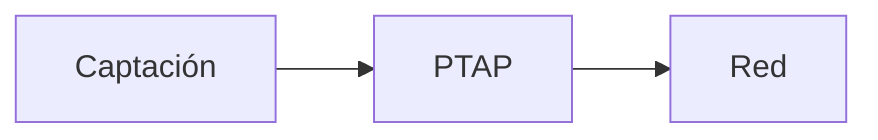

# Bienvenida

Bienvenido a **MarkFlow Office** — este es un documento de ejemplo del almacén local.

## Qué puedes hacer

1. Editar este documento en la app **Docs** (la vista en vivo compila KaTeX y Mermaid).
2. Exportarlo a **Word** desde la app Word (núcleo byte-preserving de GenOffice).
3. Buscar en todos tus documentos con el buscador (FTS5 local, sin internet).

## Ejemplo técnico

El caudal de diseño se estima con la ecuación de Hazen-Williams:

$$Q = 0.278 \cdot C \cdot D^{2.63} \cdot J^{0.54}$$

> Sugerencia: abre el panel ✨ IA y pregunta «¿qué ecuación usa este documento?»
> (requiere Ollama local activo, o una clave BYO-key en Configuración).
