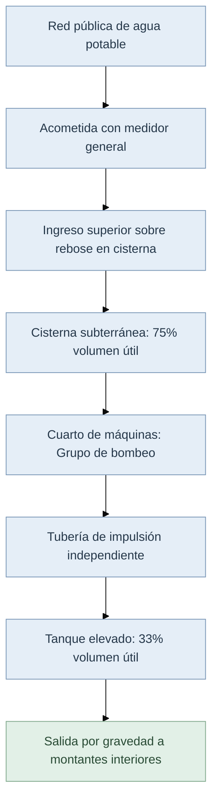

# CISTERNAS Y TANQUES ELEVADOS
# MEMORIA TÉCNICA Y ESPECIFICACIONES DE DISEÑO DE CISTERNAS Y TANQUES ELEVADOS EN EDIFICACIONES

## 1. ANTECEDENTES Y OBJETIVOS

En el diseño e ingeniería de sistemas de agua potable para edificaciones multifamiliares, comerciales e institucionales, la discontinuidad de servicio o la insuficiencia de presión piezométrica en las redes públicas de distribución exige la proyección de sistemas de almacenamiento indirecto. La combinación de depósitos de almacenamiento subterráneos (cisternas) y depósitos superiores (tanques elevados) permite garantizar la autonomía hídrica de la edificación, amortiguar las variaciones de demanda pico, asegurar presiones de servicio constantes por gravedad en los puntos de consumo y alojar las reservas de protección contra incendios.

El objetivo de esta memoria técnica es establecer de manera rigurosa, detallada y conforme a la normativa vigente, los requisitos de dimensionamiento, ubicación, geometría, aspectos constructivos, dispositivos de control hidráulico y exigencias sanitarias que deben cumplir las cisternas y los tanques elevados en edificaciones.

---

## 2. ALCANCE Y DESCRIPCIÓN DEL SISTEMA

El sistema de almacenamiento indirecto analizado comprende la infraestructura completa de captación, reserva, impulsión y distribución:

1. **Acometida y línea de alimentación**: Tubería de llegada desde la red pública municipal hasta el dispositivo de control de llenado de la cisterna.
2. **Cisterna (depósito bajo o subterráneo)**: Estructura de reserva encargada de almacenar la mayor fracción del volumen útil de regulación y la reserva de emergencia.
3. **Cuarto de máquinas y equipo de bombeo**: Instalación de impulsión con un mínimo de dos unidades de bombeo para elevar el agua desde la cisterna hacia el tanque alto.
4. **Línea de impulsión**: Tubería independiente de elevación vertical diseñada para el llenado del tanque elevado.
5. **Tanque elevado (depósito superior)**: Depósito ubicado en la cubierta o sobre la caja de escaleras para alimentar por gravedad las columnas montantes y redes interiores de distribución.

---

## 3. NORMATIVA Y MARCO DE REFERENCIA

La formulación y especificaciones presentadas se fundamentan estrictamente en los siguientes cuerpos normativos y tratados de ingeniería hidrosanitaria:

* **Norma Ecuatoriana de la Construcción NEC-11**: Capítulo 16, Norma Hidrosanitaria NHE Agua.
* **Reglamento Nacional de Edificaciones / Norma IS.010**: Instalaciones Sanitarias para Edificaciones.
* **Código Técnico de la Edificación (DB HS 4)**: Suministro de agua en edificaciones.
* **NTC 1500**: Código Colombiano de Instalaciones Hidráulicas y Sanitarias.
* **Tratados Técnicos**: Pérez Carmona (Instalaciones Hidrosanitarias), A. J. Macintyre (Manual de Instalações Hidráulicas) y Guías de ETAPA EP.

---

## 4. PARÁMETROS GENERALES DE DISEÑO Y CRITERIOS DE DIMENSIONAMIENTO

### 4.1 Determinación del Volumen Útil Total de Reserva
El volumen total de almacenamiento de agua potable debe calcularse para satisfacer el consumo total requerido por la edificación durante un periodo mínimo de **24 horas** de autonomía continua (equivalente al **100% de la dotación diaria**). En zonas con alta vulnerabilidad de desabasto, la reserva total puede dimensionarse para 2 o 3 días de consumo.

### 4.2 Reparto de Volúmenes en Sistema Combinado (Cisterna + Tanque Elevado)
Cuando la edificación dispone de un sistema combinado con grupo motor-bomba, la capacidad útil total se fracciona entre la cisterna y el tanque elevado conforme a los siguientes criterios normativos:

* **Criterio NEC-11 (Capítulo 16, Numeral 4.a)**:
  * **Cisterna (depósito subterráneo)**: **60%** del consumo diario total.
  * **Tanque elevado (depósito superior)**: **40%** del consumo diario total.

* **Criterio RNE IS.010 / Pérez Carmona / NTC 1500**:
  * **Cisterna (depósito subterráneo)**: **75%** (\\(3/4\\)) del consumo diario total.
  * **Tanque elevado (depósito superior)**: **33.33%** (\\(1/3\\)) del consumo diario total.

Ambos depósitos deben garantizar un **volumen útil mínimo absoluto de 1,000 Litros (\\(1.00 \text{ m}^3\\))** cada uno.

---

## 5. REQUISITOS SANITARIOS, ESTRUCTURALES Y CONSTRUCTIVOS

### 5.1 Requisitos Específicos de la Cisterna (Depósito Subterráneo)

1. **Ubicación y Emplazamiento**:
   * Debe localizarse en áreas comunes de fácil acceso para inspección y mantenimiento, tales como garajes, patios de servicio o bajo cajas de escaleras.
   * Se debe ubicar preferentemente en el mismo plano vertical que el tanque elevado para simplificar el trazado de la tubería de impulsión.
2. **Distancias Sanitarias de Seguridad**:
   * Distancia horizontal mayor a **3.00 m** respecto a cualquier tubería, caja de registro o conducto de desagüe de aguas servidas/negras.
   * Cota de solera o fondo ubicada a mínimo **0.50 m** por encima de la clave del tubo de alcantarillado más cercano.
   * Separación mínima de **2.00 m** respecto a linderos de propiedad o muros medianeros.
3. **Materiales y Estructura**:
   * Construcción preferente en concreto/hormigón armado revestido con aditivos impermeabilizantes integrales y cemento resistente a sulfatos.
   * Muros estructurales con un espesor mínimo de **20 cm** para evitar filtraciones del nivel freático.
   * Paredes y solera no porosas, no absorbentes y con esquinas achaflanadas para facilitar el lavado.
   * Las paredes debe elevarse al menos **0.30 m** sobre el nivel del piso terminado o terreno natural, contando con brocal o caseta de protección sanitaria exclusiva.
4. **Geometría Interna y Tirantes de Agua**:
   * Relación dimensional aconsejable entre ancho y largo de **1:2 a 1:2.5**, evitando plantas estrictamente cuadradas para prevenir zonas de estancamiento.
   * Tirante útil de agua no mayor a las **\\(3/4\\) partes (75%)** de la altura total interna de la cisterna.
   * Altura estática de succión geométrica de las bombas no mayor a **2.00 a 2.50 m** para prevenir descebados o cavitación.
   * Borde libre o cámara de aire superior entre el nivel máximo de agua y el cielo de la losa de **0.30 m a 0.40 m**.
5. **Boca de Inspección y Cuarto de Máquinas**:
   * Escotilla de acceso de dimensión mínima de **\\(0.60 \text{ m} \times 0.60 \text{ m}\\)** con tapa de cierre hermético tipo sanitario.
   * Cuarto de bombas contiguo equipado con pozo de achique y bomba de drenaje para evacuación de filtraciones o aguas de lavado.

---

### 5.2 Requisitos Específicos del Tanque Elevado (Depósito Superior)

1. **Ubicación y Apoyo Estructural**:
   * Debe apoyarse sobre la caja de escaleras o sobre pórticos y muros estructurales principales para transmitir la carga de forma segura a la cimentación.
2. **Altura Estática Mínima de Presión**:
   * El fondo del tanque elevado debe situarse a una altura estática que garantice la presión residual mínima requerida en el aparato sanitario más crítico y alejado.
   * Altura mínima del fondo del tanque de al menos **2.00 m** sobre la cota del mueble sanitario más elevado.
   * Presión residual en la grifería más desfavorable: mínimo **3.50 m c.a. a 5.00 m c.a.** para artefactos convencionales, y de **10.00 m c.a. a 15.00 m c.a.** para calentadores a gas o fluxómetros.
3. **Control Automático de Bombeo**:
   * Interruptores de nivel (conmutadores de flotador eléctrico) que comanden el arranque y paro de las bombas según los niveles mínimo y máximo de agua.

---

### 5.3 Dispositivos Sanitarios e Hidráulicos Comunes

1. **Alimentación y Control de Llenado**:
   * La entrada de agua debe realizarse siempre **por encima del nivel de rebose** (*air gap* de alimentación) para evitar conexiones cruzadas o sifonajes inversos.
   * Válvula de flotador "todo o nada", electroválvula o válvula de altitud, antecedida por una válvula de compuerta y un filtro en línea.
   * Válvula de cierre colocada inmediatamente a la salida de cada depósito.
2. **Sistema de Control de Reboses (Desborde)**:
   * Conducto de rebose colocado a una distancia vertical mínima de **0.10 m** entre la losa/tapa superior y la clave del tubo.
   * Diámetro del tubo de rebose mayor al diámetro de la tubería de alimentación y **nunca menor a 50 mm (2 pulgadas)**.
   * Descarga indirecta hacia sumideros con brecha de aire (*air gap*) libre de al menos **0.05 m (5 cm)**.
3. **Ventilación Sanitaria**:
   * Conducto de ventilación con remate en cuello de ganso orientada hacia abajo, provisto de mallas finas anti-insectos en acero inoxidable o latón.
4. **Tiempos de Llenado y Permanencia del Agua**:
   * Tubería de alimentación a cisterna: calculada para un tiempo máximo de llenado de **4 horas** (o 4 a 6 horas).
   * Tubería de impulsión a tanque elevado: calculada para un tiempo máximo de llenado de **2 horas**.
   * **Tiempo máximo de permanencia**: El agua no debe permanecer almacenada por más de **24 horas** para conservar el cloro residual y evitar la proliferación bacteriana.
5. **Mantenimiento**: Lavado y desinfección obligatorios del depósito al menos cada **6 meses**.

---

## 6. FUNDAMENTOS TEÓRICOS Y DESARROLLO DE FÓRMULAS HIDRÁULICAS

El dimensionamiento físico e hidráulico del sistema se rige por las siguientes ecuaciones fundamentales:

### 6.1 Ecuación del Volumen de Almacenamiento por Consumo
\\[
V_{\text{reserva}} = \frac{D_{\text{diaria}} \cdot N_{\text{usuarios}}}{1000}
\\]

Donde:

* **\\(V_{\text{reserva}}\\)**: Volumen útil total de almacenamiento de agua potable, en m³.
* **\\(D_{\text{diaria}}\\)**: Dotación unitaria asignada según el uso de la edificación (NEC-11 Tabla 16.2), en L/hab/día o L/m²/día.
* **\\(N_{\text{usuarios}}\\)**: Número total de habitantes, usuarios o metros cuadrados servidos en la edificación.

---

### 6.2 Reparto de Volúmenes (Sistema Combinado)
\\[
V_{\text{cisterna}} = 0.75 \cdot V_{\text{reserva}}
\\]

Donde:

* **\\(V_{\text{cisterna}}\\)**: Volumen útil mínimo de la cisterna subterránea, en m³.
* **\\(V_{\text{reserva}}\\)**: Volumen útil total de almacenamiento diario, en m³.

\\[
V_{\text{elevado}} = 0.333 \cdot V_{\text{reserva}}
\\]

Donde:

* **\\(V_{\text{elevado}}\\)**: Volumen útil mínimo del tanque elevado, en m³.
* **\\(V_{\text{reserva}}\\)**: Volumen útil total de almacenamiento diario, en m³.

---

### 6.3 Caudal de Alimentación de la Red Pública a la Cisterna
\\[
Q_{\text{alimentación}} = \frac{V_{\text{cisterna}}}{t_{\text{llenado}}}
\\]

Donde:

* **\\(Q_{\text{alimentación}}\\)**: Caudal medio de llenado desde la red exterior, en m³/s o L/s.
* **\\(V_{\text{cisterna}}\\)**: Volumen útil de almacenamiento de la cisterna, en m³ o L.
* **\\(t_{\text{llenado}}\\)**: Tiempo máximo de llenado programado (máximo 14,400 s o 4 h), en s.

---

### 6.4 Caudal de Impulsión del Equipo de Bombeo
\\[
Q_{\text{bombeo}} = \frac{V_{\text{elevado}}}{t_{\text{impulsión}}}
\\]

Donde:

* **\\(Q_{\text{bombeo}}\\)**: Caudal de entrega de la bomba hacia el tanque elevado, en m³/s o L/s.
* **\\(V_{\text{elevado}}\\)**: Volumen útil del tanque elevado, en m³ o L.
* **\\(t_{\text{impulsión}}\\)**: Tiempo máximo de llenado del tanque elevado (máximo 7,200 s o 2 h), en s.

---

## 7. TABLA TÉCNICA COMPARATIVA Y REQUISITOS NORMATIVOS

### Cuadro 1: Matriz Parámetrica y Requisitos Reglamentarios para Cisternas y Tanques Elevados

| Parámetro / Componente | Cisterna Subterránea | Tanque Elevado | Referencia Normativa |
| :--- | :--- | :--- | :--- |
| **Fracción del Volumen Útil** | 60% a 75% del consumo diario total | 33% a 40% del consumo diario total | NEC-11 Cap. 16 / IS.010 |
| **Volumen Mínimo Absoluto** | 1,000 Litros (\\(1.00 \text{ m}^3\\)) | 1,000 Litros (\\(1.00 \text{ m}^3\\)) | RNE IS.010 |
| **Tiempo Máximo de Llenado** | 4 horas (a través de acometida) | 2 horas (mediante equipo de bombeo) | NEC-11 Numeral 5.(1) |
| **Espesor Mínimo de Muros** | 20 cm en concreto armado impermeabilizado | Definido por diseño estructural (concreto/PE) | Pérez Carmona / IPN |
| **Distancia a Aguas Negras** | \\(\ge 3.00 \text{ m}\\) horizontal / \\(\ge 0.50 \text{ m}\\) vertical | No aplica (ubicado en azotea/cubierta) | NEC-11 Numeral 4.(8).j |
| **Boca de Inspección** | \\(\ge 0.60 \text{ m} \times 0.60 \text{ m}\\) sanitaria | \\(\ge 0.60 \text{ m} \times 0.60 \text{ m}\\) sanitaria | NEC-11 Numeral 4.(8).i |
| **Diámetro Mínimo Rebose** | \\(\ge 50 \text{ mm}\\) (2") con descarga indirecta | \\(\ge 50 \text{ mm}\\) (2") con descarga indirecta | NEC-11 Numeral 4.(8).f |
| **Presión Residual Mínima** | No aplica (succión por bombas) | \\(\ge 3.50 \text{ a } 5.00 \text{ m c.a.}\\) en grifería | NEC-11 / RNE IS.010 |

---

## 8. DIAGRAMA DE FLUJO DEL SISTEMA DE ALMACENAMIENTO (MERMAID)

---

## 9. CONCLUSIONES Y RECOMENDACIONES

1. **Garantía de Potabilidad**: Las cisternas y tanques elevados deben diseñarse garantizando un tiempo máximo de permanencia del agua de **24 horas**, incorporando tapas sanitarias herméticas, tubos de ventilación con malla anti-insectos y reboses con brecha de aire de mínimo 5 cm.
2. **Dimensionamiento Estructural**: Muros de cisterna en concreto armado con aditivo impermeabilizante integral y espesor no menor a 20 cm para resistir empujes de terreno y evitar filtraciones del nivel freático.
3. **Eficiencia Hidráulica**: La geometría interna debe mantener una proporción de 1:2 a 1:2.5, con tuberías de impulsión independientes diseñadas para llenar el tanque elevado en un máximo de 2 horas.

---

## REFERENCIAS TÉCNICAS

 Ministerio de Desarrollo Urbano y Vivienda. (2011). *Norma Ecuatoriana de la Construcción NEC-11: Capítulo 16 NHE Agua (Norma Hidrosanitaria de Agua Potable y Evacuación de Desechos)*. MDUVI, Quito, Ecuador.

 Pérez Carmona, R. (2018). *Instalaciones hidrosanitarias, de gas y de aprovechamiento de aguas lluvias en edificaciones*. 8va Edición, Ediciones de la U, Bogotá, Colombia.

 Macintyre, A. J. (2010). *Manual de Instalações Hidráulicas e Sanitárias*. Editora Guanabara Dois, Rio de Janeiro, Brasil.

 Instituto Colombiano de Normas Técnicas y Certificación. (2017). *NTC 1500: Código Colombiano de Instalaciones Hidráulicas y Sanitarias*. ICONTEC, Bogotá, Colombia.

 Ministerio de Vivienda, Construcción y Saneamiento. (2006). *Reglamento Nacional de Edificaciones: Norma IS.010 Instalaciones Sanitarias para Edificaciones*. SENSICO, Lima, Perú.
