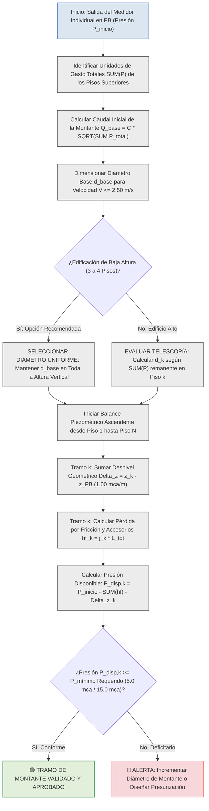

# MEMORIA TÉCNICA DE INGENIERÍA HIDRÁULICA: DIMENSIONAMIENTO DE COLUMNAS MONTANTES VERTICALES Y BALANCE DE PÉRDIDAS ACUMULADAS POR PISO

---

## 1. MARCO CONCEPTUAL Y CRITERIOS DE DIMENSIONAMIENTO EN COLUMNAS MONTANTES VERTICALES

En el diseño de sistemas de distribución de agua potable a presión para edificaciones multifamiliares o de uso mixto, la columna montante vertical (o bajante de distribución) que nace a la salida de cada medidor y se eleva hacia los departamentos superiores constituye la arteria principal de abastecimiento.

Ante las dos interrogantes planteadas sobre la estrategia de cálculo para esta conducción vertical, la ingeniería hidráulica establece las siguientes directrices normativas:

### 1.1 ¿Se diseña por acumulación de peso de aparatos por piso o se lleva el diámetro más desfavorable de forma uniforme?
**Se diseña evaluando la acumulación decreciente de Unidades de Gasto (\\(\sum P\\)) tramo a tramo, pero se debe aplicar el Criterio de Telescopía y Estabilidad de Presión.**

1. **Acumulación Trófica de Cargas (\\(\sum P\\)):**
   * El tramo base de la montante (tramo en Planta Baja entre el medidor y la primera derivación) transporta la totalidad de los aparatos de todos los pisos alimentados por ese medidor (\\(\sum P_{\text{total}}\\)).
   * A medida que la columna asciende y entrega caudal al primer y segundo piso, la carga remanente que debe subir hacia los niveles superiores se reduce (\\(\sum P_{\text{remanente}}\\)).

2. **Decisión entre Diámetro Telescópico (Variable) o Diámetro Uniforme (Constante):**
   * **Opción A — Diámetro Uniforme (Recomendado en Edificios de 3 a 5 Pisos):** En edificaciones de baja a media altura, la práctica de ingeniería recomendada consiste en **mantener el diámetro uniforme del tramo base más cargado (el del tramo inicial) en toda la altura de la montante**. Esto evita pérdidas por accesorios reductores, simplifica el montaje constructivo, reduce ruidos por turbulencia y protege la presión residual en el último piso.
   * **Opción B — Diámetro Telescópico (Reducción por Tramos):** En edificaciones de gran altura o cuando existe una reducción drástica de aparatos en los niveles superiores, se permite reducir el diámetro de la montante piso a piso. Sin embargo, la norma **NEC-11 (Sección 16.5)** exige cumplir estrictamente el **Criterio de Telescopía**: *el diámetro en el sentido del flujo (aguas abajo) jamás puede ser mayor que el diámetro de aguas arriba (tramo inferior)*.

---

### 1.2 ¿Se deben considerar las pérdidas de carga acumuladas por piso para este diseño?
**SÍ, de manera obligatoria y determinante.**

Para dimensionar y validar la columna montante vertical no basta con verificar la velocidad del agua (\\(V \le 2.50 \text{ m/s}\\)); se debe realizar el **balance piezométrico acumulado** por las siguientes dos razones físicas:

1. **Desnivel Geométrico Estático (\\(\Delta z\\)):** Cada metro de elevación vertical de la columna montante consume exactamente **1.00 m.c.a.** de presión por concepto de carga estática gravitacional.
2. **Pérdida por Fricción Viscosa y Accesorios (\\(h_{\text{f}}\\)):** A medida que el fluido asciende, la fricción continua en la pared de PVC y la turbulencia localizada en tees y codos disipan energía hidráulica (\\(j \cdot L_{\text{tot}}\\)).

La pérdida acumulada a lo largo de la columna montante determina la **presión disponible de entrada** en el colector de cada departamento, permitiendo identificar si el agua llegará con la presión residual mínima requerida (\\(5.0 \text{ m.c.a.}\\) para griferías estándar o \\(15.0 \text{ m.c.a.}\\) para encendido de calefones a gas).

---

## 2. FORMULACIÓN MATEMÁTICA CENTRAL DEL CÁLCULO EN MONTANTES

Para la automatización en software o el cómputo en memorias de diseño, la evaluación hidráulica y piezométrica de la columna montante vertical se rige por las siguientes ecuaciones analíticas:

### 2.1 Caudal Simultáneo de Diseño del Tramo de Montante \\(k\\)
La demanda volumétrica en cada tramo vertical de la columna se calcula en función de la sumatoria de pesos de Hunter remanentes aguas arriba en el flujo:

\\[Q_k = C \cdot \sqrt{\left(\sum P\right)_k}\\]

* **\\(Q_k\\)**: Caudal simultáneo máximo probable de diseño que transita por el tramo vertical \\(k\\) de la columna montante, expresado en litros por segundo (\\(\text{L/s}\\)) o metros cúbicos por segundo (\\(\text{m}^3/\text{s}\\)).
* **\\(C\\)**: Coeficiente empírico de simultaneidad global de la red a presión, fijado en \\(0.25 \text{ L/s}\\) por la norma NEC-11.
* **\\(\left(\sum P\right)_k\\)**: Sumatoria acumulada de Unidades de Gasto o pesos de Hunter de los aparatos sanitarios alimentados por la montante desde el piso \\(k\\) hasta el último nivel, adimensional.

---

### 2.2 Diámetro Interior Teórico Mínimo por Criterio Cinemático
Para garantizar que la velocidad no rebase el límite normativo de \\(2.50 \text{ m/s}\\) y prevenir el golpe de ariete o desgaste de tuberías:

\\[d_{\text{teórico, } k} = \sqrt{\frac{4 \cdot Q_k}{\pi \cdot V_{\text{máx}}}}\\]

* **\\(d_{\text{teórico, } k}\\)**: Diámetro interior teórico mínimo de la tubería en el tramo de montante \\(k\\), expresado en metros (\\(\text{m}\\)) o milímetros (\\(\text{mm}\\)).
* **\\(Q_k\\)**: Caudal volumétrico simultáneo de diseño en el tramo \\(k\\), expresado en metros cúbicos por segundo (\\(\text{m}^3/\text{s}\\)).
* **\\(V_{\text{máx}}\\)**: Velocidad máxima admisible en la conducción vertical, establecida en \\(2.50 \text{ m/s}\\) normativos.
* **\\(\pi\\)**: Constante matemática de relación circular (\\(\approx 3.14159265\\)).

---

### 2.3 Gradiente de Pérdida Unitaria por Fricción (Fair-Whipple-Hsiao)
La pérdida de energía continua por metro lineal de columna vertical en PVC a 20 °C se determina mediante:

\\[j_k = 0.0008695 \cdot \frac{Q_k^{1.75}}{d_{\text{int, } k}^{4.75}}\\]

* **\\(j_k\\)**: Pérdida de carga unitaria por fricción a lo largo del tramo vertical \\(k\\), expresada en metros de columna de agua por metro lineal (\\(\text{m c.a./m}\\)).
* **\\(0.0008695\\)**: Constante empírica oficial SSOT ajustada para tuberías plásticas lisas en agua fría.
* **\\(Q_k\\)**: Caudal volumétrico de diseño que transita por el tramo \\(k\\), expresado en metros cúbicos por segundo (\\(\text{m}^3/\text{s}\\)).
* **\\(d_{\text{int, } k}\\)**: Diámetro interior real de la tubería seleccionada para el tramo \\(k\\), expresado en metros (\\(\text{m}\\)).

---

### 2.4 Pérdida Piezométrica Acumulada en la Montante hasta el Piso \\(k\\)
La disipación total de energía por rozamiento y accesorios a lo largo de la columna vertical desde la Planta Baja hasta el nivel \\(k\\) se evalúa como:

\\[h_{\text{f, acum (k)}} = \sum_{i=1}^{k} \left( j_i \cdot \left( L_{\text{real, } i} + \sum L_{\text{e, } i} \right) \right)\\]

* **\\(h_{\text{f, acum (k)}}\\)**: Pérdida de carga hidráulica acumulada por fricción y accesorios en la montante desde la salida del medidor hasta el piso \\(k\\), expresada en metros de columna de agua (\\(\text{m c.a.}\\)).
* **\\(j_i\\)**: Pérdida unitaria por fricción en el segmento vertical \\(i\\), expresada en metros de columna de agua por metro (\\(\text{m c.a./m}\\)).
* **\\(L_{\text{real, } i}\\)**: Longitud física vertical del entrepiso \\(i\\), expresada en metros (\\(\text{m}\\)).
* **\\(\sum L_{\text{e, } i}\\)**: Sumatoria de longitudes equivalentes de accesorios en el tramo \\(i\\) (tees de derivación, codos de alza, válvulas de corte), expresada en metros (\\(\text{m}\\)).

---

### 2.5 Presión Residual Disponible a la Entrada del Piso \\(k\\)
La presión manométrica disponible a la llegada de cada departamento o subred del piso \\(k\\) resulta de aplicar el balance de energía ascendente de Bernoulli:

\\[P_{\text{disponible, } k} = P_{\text{inicio}} - h_{\text{f, acum (k)}} - \Delta z_k\\]

* **\\(P_{\text{disponible, } k}\\)**: Presión piezométrica manométrica efectiva a la entrada de la red interior del piso \\(k\\), expresada en metros de columna de agua (\\(\text{m c.a.}\\)).
* **\\(P_{\text{inicio}}\\)**: Presión piezométrica disponible a la salida del medidor individual en Planta Baja (tras descontar la pérdida de la acometida y del contador), expresada en metros de columna de agua (\\(\text{m c.a.}\\)).
* **\\(h_{\text{f, acum (k)}}\\)**: Pérdida de carga acumulada en la columna montante hasta el piso \\(k\\), expresada en metros de columna de agua (\\(\text{m c.a.}\\)).
* **\\(\Delta z_k\\)**: Desnivel geométrico topográfico o cota de elevación vertical desde el nivel del medidor en PB hasta la cota del piso \\(k\\) (\\(z_k - z_{\text{PB}}\\)), expresado en metros (\\(\text{m}\\)).

---

## 3. CUADROS TÉCNICOS Y MATRICES DE DECISIÓN DE INGENIERÍA

### Cuadro 1: Matriz Comparativa: Montante Telescópica (Reductible) vs. Montante Uniforme (Constante)

| Criterio de Selección | Montante de Diámetro Uniforme (Constante) | Montante Telescópica (Diámetro Reductible) | Dictamen y Regla de Proyecto Recomendada |
| :--- | :--- | :--- | :--- |
| **Definición Técnica** | Se mantiene el diámetro del tramo base en todos los pisos. | Se reduce el diámetro en los pisos altos según \\(\sum P\\). | **EDIFICIOS DE 3 A 4 PISOS:** Preferir Diámetro Uniforme. |
| **Comportamiento Hidráulico**| Menores velocidades en tramos superiores; menor fricción \\(j\\). | Mayor velocidad en tramos superiores; mayor gradiente \\(j\\). | El diámetro constante protege la presión en el último piso. |
| **Pérdida por Accesorios** | Elimina accesorios reductores en la línea vertical. | Requiere reducciones en cada Tee de derivación. | Menor disipación de carga por accesorios en diámetro constante. |
| **Facilidad Constructiva**| Montaje simplificado y menor riesgo de error en obra. | Exige estricto control de diámetros por nivel. | Disminuye costos de mantenimiento y repuestos. |
| **Restricción Normativa** | Cumple sobradamente la velocidad y telescopía. | Debe verificar estrictamente \\(V \le 2.50 \text{ m/s}\\). | **REGLA ABSOLUTA:** Jamás colocar un diámetro menor abajo. |

---

### Cuadro 2: Ejemplo de Balance Piezométrico Ascendente y Acumulación por Tramo de Montante (Edificio de 3 Pisos)

| Tramo de Montante | Nivel Servido | Cargas Servidas \\(\sum P\\) | Caudal \\(Q_k\\) (L/s) | Diámetro Sugerido | Velocidad \\(V_k\\) (m/s) | Loss Unit \\(j_k\\) (mca/m) | Desnivel \\(\Delta z_k\\) (m) | Loss Fricción \\(h_{\text{f, acum}}\\)(mca) | Presión Entrada Piso \\(P_{\text{disp}}\\)(mca) | Estado Piezométrico |
| :--- | :--- | :---: | :---: | :---: | :---: | :---: | :---: | :---: | :---: | :--- |
| **Salida Medidor PB**| Planta Baja | **12.40 UM** | **0.880 L/s** | **1 1/4" (32 mm)** | **1.01 m/s** | **0.021 mca/m** | 0.00 m | 0.00 mca | **25.70 m c.a.** | 🟢 Punto de Partida \\(P_{\text{inicio}}\\) |
| **Base \\(\rightarrow\\) Piso 1**| Piso 1, 2 y 3 | **11.60 UM** | **0.851 L/s** | **1" (25 mm)** | **1.73 m/s** | **0.083 mca/m** | +3.20 m | 0.45 mca | **22.05 m c.a.** | 🟢 **CONFORME** (\\(> 15.0 \text{ mca}\\)) |
| **Piso 1 \\(\rightarrow\\) Piso 2**| Piso 2 y 3 | **7.30 UM** | **0.675 L/s** | **1" (25 mm)** | **1.38 m/s** | **0.055 mca/m** | +6.00 m | 0.68 mca | **19.02 m c.a.** | 🟢 **CONFORME** (\\(> 15.0 \text{ mca}\\)) |
| **Piso 2 \\(\rightarrow\\) Piso 3**| Solo Piso 3 | **3.00 UM** | **0.433 L/s** | **3/4" (20 mm)** | **1.38 m/s** | **0.093 mca/m** | +8.80 m | 1.00 mca | **15.90 m c.a.** | 🟢 **CUMPLE CALEFÓN** (\\(> 15.0 \text{ mca}\\)) |

---

## 4. DIAGRAMA LÓGICO DE TOMA DE DECISIONES Y PROPAGACIÓN DE ENERGÍA (MERMAID)

El siguiente esquema en Mermaid modela la secuencia lógica para determinar el diámetro y el balance piezométrico de la columna montante vertical, utilizando colores normados sin fondos amarillos:

---

## 5. CONCLUSIONES Y SÍNTESIS TÉCNICA

1. **Sobre la Cargas de Pesos (\\(\sum P\\)):** La columna montante vertical se diseña evaluando la acumulación decreciente de Unidades de Gasto de Hunter desde la base en Planta Baja hasta el último nivel.
2. **Sobre la Selección del Diámetro:** En edificios de 3 a 4 pisos, la mejor práctica de ingeniería es **adoptar un solo diámetro uniforme constante en toda la montante** (el del tramo base en Planta Baja). Si se reduce el diámetro en los pisos superiores (telescopía), jamás se debe vulnerar la regla de que el diámetro inferior debe ser igual o mayor al superior.
3. **Sobre las Pérdidas Acumuladas:** **Es indispensable calcular la pérdida de carga acumulada por piso (\\(h_{\text{f, acum}}\\))** sumando el desnivel geométrico y la fricción continua de los accesorios. Este balance garantiza que el agua llegue con una presión residual suficiente al departamento y calefón del nivel más alto.

---

## FUENTES Y REFERENCIAS CITADAS (NUMERADAS)

* [1 NEC-11 CAP 16 NORMA HIDROSANITARIA NHE AGUA.pdf](https://notebooklm.google.com) — *Ministerio de Desarrollo Urbano y Vivienda (MIDUVI). Norma Ecuatoriana de la Construcción NEC-11: Capítulo 16 NHE Agua.*
* [4 PEREZ CARMONA (Instalaciones hidrosanitarias) - Hidroclic.pdf](https://notebooklm.google.com) — *Pérez Carmona, Rafael. Instalaciones hidrosanitarias, de gas y de aprovechamiento de aguas lluvias en edificaciones. 8va Edición.*
* [Memoria_Calculo_Hidrosanitaria_AF-SR_LEMA.md](https://notebooklm.google.com) — *Larriva, Ing. Memoria de Cálculo Hidrosanitaria AF-SR y Tratado de Ingeniería Hidrosanitaria.*
* [SEMINARIO DE DISEÑO HIDROSANITARIO 1 & 2](https://notebooklm.google.com) — *Bustamante Carbo, Gino. Seminario de Diseño Hidrosanitario: Caudales, Presiones Residuales y Pérdidas.*

---

💡 *Esta respuesta ofrece el sustento técnico de ingeniería, la formulación matemática en LaTeX y las matrices de decisión para respaldar el módulo de cálculo de columnas montantes en tu aplicación o memoria de proyecto.*
