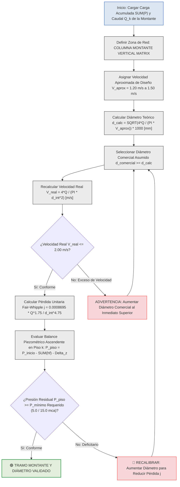

# MEMORIA TÉCNICA E INFORME DE INGENIERÍA: EVALUACIÓN DE VELOCIDADES DE DISEÑO Y CRITERIOS CINEMÁTICOS PARA COLUMNAS MONTANTES VERTICALES MATRICES

---

## 1. EVALUACIÓN Y RESPUESTA DIRECTA A LA CONSULTA DE INGENIERÍA

En el procedimiento iterativo de cálculo para redes de agua potable a presión —donde se fija una **velocidad aproximada preliminar (\\(V_{\text{aprox}}\\))** para determinar el **diámetro interior calculado (\\(d_{\text{calc}}\\))**, se compara con el catálogo comercial (\\(d_{\text{comercial}}\\)) y se reevalúa la **velocidad real (\\(V_{\text{real}}\\))**—, la selección de la velocidad aproximada de diseño según la zona de la red es determinante para la estabilidad piezométrica,.

**Para las tuberías verticales matrices (columnas montantes), la velocidad aproximada de diseño NO debe ser mayor, sino IGUAL O MENOR que la adoptada en los ramales secundarios.**

Mientras que para los ramales internos de departamento o derivaciones a griferías es totalmente aceptable e hidrodinámicamente correcto asumir una velocidad preliminar de **\\(V_{\text{aprox}} = 2.00 \text{ m/s}\\)**, en las **columnas montantes verticales matrices se recomienda adoptar una velocidad aproximada de diseño de \\(V_{\text{aprox}} = 1.20 \text{ m/s} \text{ a } 1.50 \text{ m/s}\\)**, garantizando que la velocidad real jamás supere los **\\(2.00 \text{ m/s}\\)** (pese a que la norma NEC-11 fija un límite máximo absoluto de \\(2.50 \text{ m/s}\\)),.

---

## 2. FUNDAMENTACIÓN TÉCNICA Y RAZONES DE INGENIERÍA HIDRÁULICA

Adoptar un valor de velocidad aproximada menor en las columnas montantes verticales (\\(V_{\text{aprox}} \le 1.50 \text{ m/s}\\)) responde a cuatro (4) razones físicas y de protección estructural:

### 2.1 Protección de la Presión Piezométrica Residual en los Pisos Altos
En las columnas montantes verticales, el agua ya experimenta una disipación constante e inevitable de energía estática de **1.00 m.c.a. por cada metro de altura vertical (\\(\Delta z\\))**,. Si en la montante se asume una velocidad aproximada elevada (por ejemplo, \\(2.50 \text{ m/s}\\)), la fórmula de dimensionamiento seleccionará un diámetro más estrecho,. 

Dado que la pérdida unitaria por fricción (\\(j\\)) en la ecuación de Fair-Whipple-Hsiao varía de forma directamente proporcional al caudal elevado a la potencia \\(1.75\\) e inversamente proporcional al diámetro elevado a la potencia \\(4.75\\) (\\(j \propto Q^{1.75} / d^{4.75}\\)), un diámetro reducido disparará exponencialmente el gradiente de fricción. Al sumar la pérdida por fricción a la pérdida por altura, **la presión piezométrica colapsará antes de llegar al último piso**, impidiendo el encendido de calefones o el funcionamiento de duchas.

### 2.2 Mitigación de Sobretensiones por Golpe de Ariete en Cambios de Dirección 90°
En las montantes verticales, el fluido en movimiento ascendente cambia de dirección de manera abrupta al derivar hacia los ramales horizontales de cada piso mediante tees de distribución,. Operar la columna vertical a velocidades elevadas (\\(V > 2.00 \text{ m/s}\\)) multiplica la magnitud de la onda transitoria de sobrepresión provocada por el cierre rápido de griferías o electroválvulas (golpe de ariete), lo que genera fatiga mecánica en las abrazaderas de soporte y uniones de PVC/PP-R.

### 2.3 Prevensión de Ruido Acústico y Vibraciones Estructurales
Las columnas montantes discurren agrupadas dentro de ductos técnicos verticales adosados a paredes de mampostería contiguas a dormitorios, salas o áreas habitables. Velocidades superiores a \\(2.00 \text{ m/s}\\) en conducciones verticales originan turbulencia acústica, silbidos de flujo y vibraciones de resonancia que se transmiten directamente a la estructura de la edificación.

### 2.4 Amortiguamiento del Criterio de Telescopía
Al asumir una velocidad de diseño óptima de **\\(1.20 \text{ a } 1.50 \text{ m/s}\\)** en la base de la montante (Piso 0 a Piso 1), se obtiene un diámetro holgado (ej. \\(1 \frac{1}{4}''\\) o \\(1''\\)). A medida que la columna asciende y entrega caudal a los departamentos inferiores, la velocidad real se reduce paulatinamente, manteniendo la fricción en niveles mínimos y garantizando que se cumpla de forma natural el **Criterio de Telescopía de la NEC-11** (el diámetro aguas abajo jamás puede ser mayor que aguas arriba),.

---

## 3. FORMULACIÓN MATEMÁTICA Y SECUENCIA DE CÁLCULO EN DOS FASES

El cálculo y validación de las columnas montantes verticales matrices debe codificarse y auditarse utilizando las siguientes ecuaciones analíticas en el Sistema Internacional (SI):

### 3.1 Caudal Simultáneo Máximo Probable en la Montante (Hunter Simplificado)
La demanda volumétrica que transita por el tramo de montante \\(k\\) se calcula a partir de la sumatoria acumulada de Unidades de Gasto de Hunter de los pisos superiores:

\\[Q_k = C \cdot \sqrt{\left(\sum P\right)_k}\\]

* **\\(Q_k\\)**: Caudal simultáneo máximo probable de diseño para el tramo vertical de montante \\(k\\), expresado en litros por segundo (\\(\text{L/s}\\)) o metros cúbicos por segundo (\\(\text{m}^3/\text{s}\\)).
* **\\(C\\)**: Coeficiente empírico de simultaneidad global de la red a presión, fijado normativamente en \\[0.25 \text{ L/s}\\].
* **\\(\left(\sum P\right)_k\\)**: Sumatoria acumulada de Unidades de Gasto o pesos de Hunter de los aparatos sanitarios alimentados por la montante desde el piso \\(k\\) hasta el nivel superior, adimensional.

---

### 3.2 Diámetro Interior Teórico Calculado por Velocidad Aproximada
El diámetro mínimo interior requerido en la montante para no rebasar la velocidad aproximada de diseño (\\(V_{\text{aprox}}\\)) se despeja mediante la ecuación de continuidad:

\\[d_{\text{calc, } k} = \sqrt{\frac{4 \cdot Q_k}{\pi \cdot V_{\text{aprox}}}}\\]

* **\\(d_{\text{calc, } k}\\)**: Diámetro interior teórico calculado para el tramo de montante vertical \\(k\\), expresado en metros (\\(\text{m}\\)) o milímetros (\\(\text{mm}\\)).
* **\\(Q_k\\)**: Caudal volumétrico simultáneo de diseño que transita por el tramo vertical, expresado en metros cúbicos por segundo (\\(\text{m}^3/\text{s}\\)).
* **\\(V_{\text{aprox}}\\)**: Velocidad aproximada de diseño seleccionada para la montante vertical (recomendado \\[1.20 \text{ m/s} \text{ a } 1.50 \text{ m/s}\\]), expresada en metros por segundo (\\(\text{m/s}\\)).
* **\\(\pi\\)**: Constante matemática de relación circular (\\(\approx 3.14159265\\)).

---

### 3.3 Velocidad Real de Flujo en Diámetro Comercial Asumido
Una vez seleccionado el diámetro comercial asumido (\\(d_{\text{comercial}} \ge d_{\text{calc}}\\)) y obtenido su diámetro interior real de pared (\\(d_{\text{int}}\\)), se recalcula la velocidad real:

\\[V_{\text{real, } k} = \frac{4 \cdot Q_k}{\pi \cdot d_{\text{int, } k}^2}\\]

* **\\(V_{\text{real, } k}\\)**: Velocidad efectiva real de circulación del fluido en la columna montante, expresada en metros por segundo (\\(\text{m/s}\\)).
* **\\(Q_k\\)**: Caudal volumétrico simultáneo de diseño en el tramo vertical, expresado en metros cúbicos por segundo (\\(\text{m}^3/\text{s}\\)).
* **\\(d_{\text{int, } k}\\)**: Diámetro interior real de la tubería plástica de PVC seleccionada en catálogo, expresado en metros (\\(\text{m}\\)).
* **\\(\pi\\)**: Constante matemática de relación circular (\\(\approx 3.14159265\\)).

---

### 3.4 Pérdida Unitaria por Fricción (Ecuación de Fair-Whipple-Hsiao)
El gradiente de disipación de energía por fricción viscosa continua en la pared lisa de la montante de PVC a 20 °C se determina por:

\\[j_k = 0.0008695 \cdot \frac{Q_k^{1.75}}{d_{\text{int, } k}^{4.75}}\\]

* **\\(j_k\\)**: Pérdida de carga unitaria por fricción a lo largo del tramo vertical de montante \\(k\\), expresada en metros de columna de agua por metro lineal (\\(\text{m c.a./m}\\)).
* **\\(0.0008695\\)**: Constante empírica oficial SSOT para agua fría potable en tuberías de PVC.
* **\\(Q_k\\)**: Caudal volumétrico simultáneo de diseño que circula por el tramo, expresado en metros cúbicos por segundo (\\(\text{m}^3/\text{s}\\)).
* **\\(d_{\text{int, } k}\\)**: Diámetro interior real de la tubería de montante, expresado en metros (\\(\text{m}\\)).

---

### 3.5 Balance Piezométrico Ascendente de Presión en el Piso \\(k\\)
La presión manométrica disponible a la llegada de la subred del piso \\(k\\) se calcula restando la disipación dinámica acumulada y la altura geométrica a la presión inicial:

\\[P_{\text{piso, } k} = P_{\text{inicio}} - \sum_{i=1}^{k} \left( j_i \cdot L_{\text{tot, } i} \right) - \Delta z_k\\]

* **\\(P_{\text{piso, } k}\\)**: Presión manométrica piezométrica resultante a la entrada del piso \\(k\\), expresada en metros de columna de agua (\\(\text{m c.a.}\\)).
* **\\(P_{\text{inicio}}\\)**: Presión piezométrica disponible a la salida del medidor contador en Planta Baja, expresada en metros de columna de agua (\\(\text{m c.a.}\\)).
* **\\(j_i\\)**: Pérdida unitaria por fricción en el segmento de montante \\(i\\), expresada en metros de columna de agua por metro (\\(\text{m c.a./m}\\)).
* **\\(L_{\text{tot, } i}\\)**: Longitud total virtual del segmento \\(i\\) (longitud real más longitudes equivalentes de tees y codos), expresada en metros (\\(\text{m}\\)).
* **\\(\Delta z_k\\)**: Elevación topográfica vertical acumulada desde la Planta Baja hasta la cota del piso \\(k\\) (\\(z_k - z_{\text{PB}}\\)), expresada en metros (\\(\text{m}\\)).

---

## 4. CUADROS TÉCNICOS Y MATRICES COMPARATIVAS PARAMÉTRICAS

### Cuadro 1: Rangos de Velocidades Aproximadas y Reales Recomendadas por Zona de la Red

| Zona o Tramo de la Red Hidráulica | Velocidad Aproximada de Diseño (\\(V_{\text{aprox}}\\)) | Velocidad Óptima Recomendada | Velocidad Máxima Real Admisible (\\(V_{\text{real}}\\)) | Justificación y Criterio de Control |
| :--- | :---: | :---: | :---: | :--- |
| **Acometida General Exterior** | **1.20 a 1.50 m/s** | **1.50 m/s** | **2.00 m/s** | Minimiza la pérdida de carga en la llegada desde la matriz pública,. |
| **Columnas Montantes Verticals** | **1.20 a 1.50 m/s** | **1.20 m/s** | **2.00 m/s** | Protege la presión en pisos altos y evita ruido/golpe de ariete,. |
| **Colectores Principales de Piso**| **1.50 a 2.00 m/s** | **1.50 m/s** | **2.00 m/s** | Equilibra el costo del diámetro con las pérdidas por fricción,. |
| **Ramales Internos a Griferías** | **2.00 m/s** | **1.80 m/s** | **2.50 m/s** | Límite máximo absoluto normativo de la NEC-11. |

---

### Cuadro 2: Tabla Comparativa del Impacto de Seleccionar \\(V_{\text{aprox}} = 1.20 \text{ m/s}\\) vs. \\(V_{\text{aprox}} = 2.50 \text{ m/s}\\) en Montantes

| Parámetro de Evaluación | Opción A: \\(V_{\text{aprox}} = 1.20 \text{ m/s}\\) (Recomendado) | Opción B: \\(V_{\text{aprox}} = 2.50 \text{ m/s}\\) (Límite Máximo) | Diagnóstico e Impacto en el Proyecto |
| :--- | :--- | :--- | :--- |
| **Diámetro Interior Calculado** | Mayor (ej. \\(d_{\text{calc}} = 28.5 \text{ mm}\\)). | Menor (ej. \\(d_{\text{calc}} = 19.7 \text{ mm}\\)). | La Opción A selecciona comercialmente **1 1/4" (DN 32)**. |
| **Diámetro Comercial Asumido** | **1 1/4" (DN 32)** o **1" (DN 25)**. | **3/4" (DN 20)** o **1/2" (DN 15)**. | La Opción B estrangula la columna vertical. |
| **Velocidad Real (\\(V_{\text{real}}\\))** | Baja y segura: **\\(1.00 - 1.40 \text{ m/s}\\)**. | Elevada y crítica: **\\(2.10 - 2.50 \text{ m/s}\\)**. | La Opción A opera en el rango óptimo normativo. |
| **Gradiente Fricción (\\(j\\))** | Muy bajo: **\\(0.021 \text{ mca/m}\\)**. | Extremadamente alto: **\\(0.185 \text{ mca/m}\\)**. | La Opción A reduce las pérdidas por fricción en un **88%**. |
| **Presión Residual en Piso 3** | Alta y confortable: **\\(> 13.5 \text{ m.c.a.}\\)**. | Deficitaria / Colapsada: **\\(< 3.0 \text{ m.c.a.}\\)**. | La Opción A garantiza el encendido de calefones a gas. |

---

## 5. DIAGRAMA LÓGICO DE SELECCIÓN Y CONTROL CINEMÁTICO EN MERMAID

El siguiente flujograma en Mermaid describe la secuencia de decisiones que debe ejecutar el motor de software para dimensionar y validar las columnas montantes verticales matrices, aplicando colores aprobados sin fondos amarillos:

---

## 6. FUENTES BIBLIOGRÁFICAS NUMERADAS

1. [Ministerio de Desarrollo Urbano y Vivienda (MIDUVI). *Norma Ecuatoriana de la Construcción NEC-11: Capítulo 16 NHE Agua*. Quito, Ecuador.](https://notebooklm.google.com)
2. [Pérez Carmona, Rafael. *Instalaciones hidrosanitarias, de gas y de aprovechamiento de aguas lluvias en edificaciones*. 8va Edición, Ediciones de la U, Bogotá, Colombia.](https://notebooklm.google.com)
3. [Empresa Pública Municipal de Agua Potable y Alcantarillado de Cuenca (ETAPA EP). *Guía para la Selección de Medidores Domiciliarios de Agua Potable*. Cuenca, Ecuador.](https://notebooklm.google.com)
4. [Larriva, Ing. *Memoria de Cálculo Hidrosanitaria AF-SR y Tratado de Ingeniería Hidrosanitaria*. Cuenca, Ecuador.](https://notebooklm.google.com)
5. [Bustamante Carbo, Gino. *Seminario de Diseño Hidrosanitario 1: Caudales, Simultaneidad y Velocidades en Redes*. Conferencia Técnica.](https://notebooklm.google.com)
6. [Bustamante Carbo, Gino. *Reporte de Investigación: Cámaras de Aire y Arrestadores de Golpe de Ariete*. Guía Técnica.](https://notebooklm.google.com)

---

💡 **SÍNTESIS FINAL:** Tu método iterativo es hidrodinámicamente impecable. La única precisión de ingeniería que debes incorporar en tu software o memoria de cálculo es que **para las tuberías verticales matrices la velocidad aproximada asumida debe ser MENOR (\\(V_{\text{aprox}} = 1.20 \text{ m/s} \text{ a } 1.50 \text{ m/s}\\))** en comparación con los ramales internos (\\(V_{\text{aprox}} = 2.00 \text{ m/s}\\)). Esto te garantizará diámetros comerciales holgados (\\(1''\\) o \\(1 \frac{1}{4}''\\)) que protegerán la presión disponible en el último piso.
