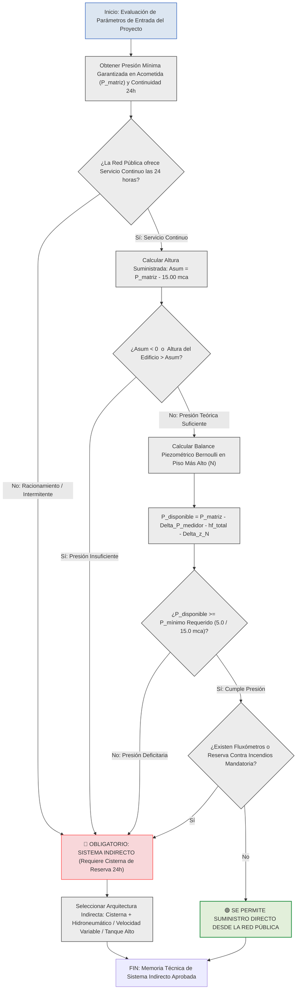

# MEMORIA TÉCNICA Y CRITERIOS DE INGENIERÍA: CONDICIONES DE OBLIGATORIEDAD Y DISEÑO PARA SISTEMAS INDIRECTOS DE ABASTECIMIENTO DE AGUA POTABLE EN EDIFICACIONES

En el ejercicio de la ingeniería e instalaciones hidrosanitarias para edificaciones residenciales, comerciales e industriales, la selección entre un sistema de suministro **directo** desde la red pública municipal y un sistema de suministro **indirecto** (mediante depósitos de almacenamiento, cisternas, tanques elevados, equipos hidroneumáticos o sistemas de bombeo de velocidad variable) constituye la decisión de diseño primaria que condiciona la seguridad sanitaria, la continuidad del servicio y la estabilidad piezométrica de la edificación , .

Un sistema indirecto se define como aquella arquitectura hidráulica en la cual el agua proveniente de la red pública no alimenta de manera directa y continua las griferías finales de los usuarios, sino que se descarga previamente en uno o varios depósitos intermedios de almacenamiento para ser posteriormente presurizada y distribuida hacia la red interior , .

---

## 1. MARCO NORMATIVO Y JUSTIFICACIÓN TÉCNICA DEL SUMINISTRO INDIRECTO

El marco normativo regido por la **Norma Ecuatoriana de la Construcción NEC-11 (Capítulo 16: NHE Agua)**, el **Código Técnico de la Edificación (DB HS 4)**, la norma **NTC 1500** y los pliegos de entidades prestadoras del servicio como **ETAPA EP**, establece que la infraestructura interior de agua potable debe garantizar el abastecimiento en **cantidad suficiente, con presiones residuales confortables y de forma ininterrumpida las 24 horas del día** , , .

Cuando la red pública exterior no puede asegurar de manera simultánea los requerimientos de caudal pico, continuidad de servicio y presión dinámica mínima a la altura del aparato sanitario más desfavorable, la normativa vuelve **estrictamente obligatorio el diseño e implementación de un sistema indirecto** , .

---

## 2. CONDICIONES TÉCNICAS Y CASOS EN QUE ES OBLIGATORIO EL DISEÑO INDIRECTO

La ingeniería hidráulica determina la necesidad de un diseño indirecto ante la presencia de uno o varios de los siguientes siete (7) desencadenantes técnicos:

### 2.1 Insuficiencia de Presión Piezométrica en la Red Pública

Ocurre cuando la presión piezométrica mínima garantizada por la empresa pública en la acometida (\(P_{\text{matriz}}\)) es inferior a la suma del desnivel topográfico del edificio (\(\Delta z\)), las pérdidas por fricción continuas y localizadas en la tubería y medidor (\(h_{\text{f}} + J_{\text{m}}\)), y la presión residual mínima exigida en el aparato sanitario más alto (\(P_{\text{mín, req}}\)) , .

### 2.2 Criterio de la Altura Suministrada (\(A_{\text{sum}}\)) Deficitaria

Según la Sección 16.5.4.1 de la norma NEC-11, se define el umbral de la **Altura Suministrada (\(A_{\text{sum}}\))**. Si la presión mínima en la acometida es menor a 15.00 m c.a. (\(A_{\text{sum}} < 0\)), o si la cota del techo del piso más alto de la edificación supera el valor de \(A_{\text{sum}}\), el sistema directo queda normativamente descartado y se exige presurización indirecta desde la Planta Baja .

### 2.3 Intermitencia, Racionamiento o Servicio Discontinuo del Acueducto

Cuando la empresa de agua potable no garantiza un suministro continuo durante las 24 horas del día (suspensiones nocturnas, fallas de estiaje o variaciones severas de presión), se requiere almacenar de forma indirecta un volumen de reserva equivalente a **100% de la dotación diaria (24 horas)** o hasta 2 a 3 días de consumo en zonas de alta vulnerabilidad , .

### 2.4 Edificaciones de Gran Altura o Múltiples Niveles

En edificios de 4, 5 o más niveles (o con alturas superiores a 12.00 metros), la carga estática necesaria para elevar el agua supera la capacidad de las presiones urbanas estándar (típicamente entre 10.0 y 20.0 m c.a.) , .

### 2.5 Instalación de Aparatos Sanitarios de Alto Caudal Instantáneo (Fluxómetros)

Los inodoros y urinarios equipados con válvulas de descarga instantánea (fluxómetros) demandan caudales de 1.20 a 3.00 L/s por unidad durante intervalos de 5 a 7 segundos, requiriendo presiones residuales de 10.0 a 15.0 m c.a. , . La acometida pública directa no puede abastecer estos picos sin provocar colapsos de presión en la red contigua.

### 2.6 Exigencia de Reserva Combinada para el Sistema Contra Incendios (SCI)

En edificaciones multifamiliares o comerciales que por normativa requieren una reserva de protección contra incendios (mínimo 18.0 a 25.0 \(\text{m}^3\)), la cisterna de almacenamiento indirecto permite alojar el volumen mixto de consumo sanitario y protección de emergencia , .

### 2.7 Aislamiento Sanitario y Protección contra el Sifonaje Inverso

En instalaciones especiales (hospitales, industrias, laboratorios o mataderos), se requiere romper la conexión física directa con la red pública mediante una **brecha de aire (*****air gap*****)** e ingrese el agua a una cisterna atmosférica, previniendo la contaminación de la red municipal por refujo o sifonaje inverso .

---

## 3. FORMULACIÓN MATEMÁTICA Y CRITERIOS ANALÍTICOS DE EVALUACIÓN

Para fundamentar la memoria de cálculo que justifica la elección de un sistema indirecto, la entidad de control audita las siguientes expresiones analíticas centradas en el Sistema Internacional (SI).

### 3.1 Ecuación de la Altura Suministrada por la Red Pública (NEC-11, Ec. 16-8)

Determina la cota vertical máxima admisible desde la calzada para poder brindar servicio directo sin necesidad de equipos de presurización :

\[A_{\text{sum}} = P_{\text{mín, acometida}} - 15.00\]

- **\(A_{\text{sum}}\)**: Altura geométrica máxima suministrada desde el nivel de la calzada para abastecimiento directo, expresada en metros de columna de agua (m c.a.).
- **\(P_{\text{mín, acometida}}\)**: Presión piezométrica manométrica mínima garantizada en la red pública municipal a nivel de acera, expresada en metros de columna de agua (m c.a.).
- **\(15.00\)**: Constante normativa de resguardo que contempla la presión residual del calentador a gas y las pérdidas de carga acumuladas en la montante (m c.a.) .

---

### 3.2 Balance Piezométrico de Verificación para Suministro Directo (Bernoulli)

Modela la presión manométrica disponible en el aparato sanitario más desfavorable o crítico del último piso \(N\) , :

\[P_{\text{disponible, } N} = P_{\text{matriz}} - \Delta P_{\text{medidor}} - h_{\text{f, acometida}} - h_{\text{f, montante}} - \Delta z_N\]

- **\(P_{\text{disponible, } N}\)**: Presión manométrica piezométrica resultante disponible en la grifería del piso más alto \(N\), expresada en metros de columna de agua (m c.a.).
- **\(P_{\text{matriz}}\)**: Presión piezométrica manométrica mínima garantizada en la red pública principal en acera, expresada en metros de columna de agua (m c.a.).
- **\(\Delta P_{\text{medidor}}\)**: Pérdida de carga localizada o caída de presión introducida por el cuerpo del medidor contador general (ISO 4064), expresada en metros de columna de agua (m c.a.) .
- **\(h_{\text{f, acometida}}\)**: Pérdida de carga acumulada por fricción en la tubería de acometida exterior, expresada en metros de columna de agua (m c.a.).
- **\(h_{\text{f, montante}}\)**: Pérdida de carga hidráulica acumulada por fricción y accesorios en la columna montante vertical, expresada en metros de columna de agua (m c.a.) .
- **\(\Delta z_N\)**: Desnivel geométrico topográfico total desde el nivel de la acera hasta la cota del aparato más alto del nivel \(N\), expresado en metros (m).

---

### 3.3 Condición de Ineficiencia Piezométrica (Veredicto de Sistema Indirecto)

Si la presión calculada en el nudo crítico no satisface el mínimo reglamentario, el sistema directo se declara no conforme , :

\[P_{\text{disponible, } N} < P_{\text{mín, req}}\]

- **\(P_{\text{disponible, } N}\)**: Presión piezométrica manométrica calculada en el punto crítico del nivel \(N\), expresada en metros de columna de agua (m c.a.).
- **\(P_{\text{mín, req}}\)**: Presión residual mínima de servicio exigida para el funcionamiento adecuado del aparato (5.0 m c.a. para griferías estándar; 15.0 m c.a. para encendido de calefones a gas; 10.0 a 15.0 m c.a. para fluxómetros), expresada en metros de columna de agua (m c.a.) , .

---

### 3.4 Dimensionamiento de Depósitos de Almacenamiento Indirecto (Cisterna + Tanque Alto)

Cuando se adopta un sistema indirecto combinado, la capacidad útil de almacenamiento se distribuye normativamente según la regla del consumo diario , :

\[V_{\text{reserva total}} = V_{\text{dotación diaria}} = \sum \left( \text{Dotación}_i \cdot \text{Unidades}_i \right)\]

\[V_{\text{cisterna}} = 0.75 \cdot V_{\text{reserva total}} \quad (\text{Mínimo } 60% \text{ a } 75%)\]

\[V_{\text{tanque alto}} = 0.33 \cdot V_{\text{reserva total}} \quad (\text{Mínimo } 30% \text{ a } 40%)\]

- **\(V_{\text{reserva total}}\)**: Volumen útil total de agua requerido para garantizar 24 horas de consumo ininterrumpido en la edificación, expresado en litros (L) o metros cúbicos (\(\text{m}^3\)) .
- **\(V_{\text{dotación diaria}}\)**: Consumo volumétrico diario estimado según el uso, área y número de habitantes (NEC-11 Tabla 16.2), expresado en litros por día (L/día) .
- **\(V_{\text{cisterna}}\)**: Volumen útil de almacenamiento asignado al depósito subterráneo o cisterna baja (75% del consumo diario), expresado en litros (L) o metros cúbicos (\(\text{m}^3\)) , .
- **\(V_{\text{tanque alto}}\)**: Volumen útil de almacenamiento asignado al depósito elevado (33% del consumo diario), expresado en litros (L) o metros cúbicos (\(\text{m}^3\)) , .

---

## 4. CUADROS TÉCNICOS COMPARATIVOS Y PARAMÉTRICOS DE DISEÑO

### Cuadro 1: Umbrales Criteriales para la Selección entre Sistema Directo e Indirecto

| Parámetro Hidráulico / Criterio | Suministro Directo (Red Pública) | Suministro Indirecto (Cisterna / Bombeo) | Normativa de Referencia |
|:---|:---|:---|:---|
| **Presión en Acometida (\(P_{\text{matriz}}\))** | \(\ge 20.0 \text{ a } 25.0 \text{ m c.a.}\) sostenida. | \(< 15.0 \text{ m c.a.}\) o variable durante el día. | NEC-11 Secc. 16.5.4.1  |
| **Altura de la Edificación** | 1 a 3 Pisos (\(\Delta z \le 9.0 \text{ m}\)). | 4 o más Pisos (\(\Delta z > 10.0 \text{ m}\)). | NTC 1500 / NEC-11  |
| **Continuidad del Servicio** | 24 horas / 365 días ininterrumpido. | Servicio discontinuo, racionamiento u horas pico. | ETAPA EP / IS.010 ,  |
| **Tipo de Aparatos Sanitarios** | Griferías de tanque, lavabos, duchas convencionales. | Presencia de fluxómetros o calentadores de paso. | Pérez Carmona (Tabla 1.1)  |
| **Reserva Contra Incendios** | No requerida o independiente. | Requerida (Cisterna mixta con reserva exclusiva). | NEC-11 Secc. 16.7.2.4  |
| **Presión Residual en Último Piso** | \(\ge 5.0 \text{ m c.a.}\) (grifería) / \(\ge 15.0 \text{ m c.a.}\) (calefón). | Deficitaria en servicio directo (\(< 5.0 \text{ m c.a.}\)). | NEC-11 Tabla 16.1  |

---

### Cuadro 2: Matriz Comparativa de Modalidades de Sistemas Indirectos de Agua Potable

| Configuración del Sistema Indirecto | Arquitectura de Componentes | Ventajas de Ingeniería | Desventajas o Limitaciones | Campo de Aplicación Típico |
|:---|:---|:---|:---|:---|
| **A. Tanque Bajo y Tanque Alto (Gravedad)** | Cisterna + Equipo de Bombeo de Llenado + Tanque Elevado. | Presiones constantes por gravedad; bajo consumo eléctrico en bombas; reserva en cubierta. | Sobrecarga estructural en cubierta; riesgo de contaminación si no se mantiene. | Edificios de 3 a 8 pisos con estructura reforzada . |
| **B. Cisterna y Equipo Hidroneumático** | Cisterna Subterránea + Bombas + Tanque Presurizado (Membrana). | Elimina el tanque elevado; mantiene presiones excelentes en toda la red interior. | Arreglo de arranques frecuentes de bomba; fluctuación de presión entre \(P_{\text{mín}}\) y \(P_{\text{máx}}\). | Edificaciones multifamiliares de 3 a 10 pisos . |
| **C. Cisterna y Bombas de Velocidad Variable** | Cisterna + Variadores de Frecuencia (VFD) + Bombas Multicelulares. | Presión 100% constante en todos los pisos; máxima eficiencia energética; menor espacio en cuarto de máquinas. | Mayor costo de inversión inicial en electrónica de control y sensores de presión. | Edificios modernos, hoteles, hospitales y torres de departamentos . |
| **D. Sistema Mixto (Directo + Indirecto)** | Pisos bajos alimentados directo; pisos altos alimentados por presurización. | Optimiza el uso de la presión pública; reduce la capacidad del equipo de bombeo. | Requiere duplicar o independizar las columnas montantes de distribución. | Edificios mixtos con locales comerciales en PB y viviendas en altura . |

---

## 5. DIAGRAMA LÓGICO DE DECISIÓN DE INGENIERÍA EN MERMAID

El siguiente flujograma en Mermaid describe la secuencia de decisiones que debe ejecutar el proyectista para dictaminar la necesidad de un diseño indirecto de agua potable, utilizando líneas ortogonales suaves y tonos técnicos sin fondos amarillos:

---

## 6. CONCLUSIONES Y RECOMENDACIONES DE PROYECTO

1. **Veredicto Técnico Justificado:** Un diseño indirecto de agua potable no es una decisión arbitraria, sino el resultado analítico de comprobar que la red pública no puede garantizar la presión residual de servicio (\(P \ge 5.0 \text{ m c.a.}\) en griferías o \(P \ge 15.0 \text{ m c.a.}\) en calefones), la reserva de agua para 24 horas o los caudales de simultaneidad requeridos , .
2. **Reserva Sanitaria Garantizada:** Al adoptar un sistema indirecto, la edificación gana autonomía e independencia frente a mantenimientos o cortes de agua del municipio, asegurando el almacenamiento mínimo reglamentario en cisternas (75% del consumo diario) y tanques elevados o hidroneumáticos , .
3. **Eficiencia Energética:** Se recomienda evaluar sistemas indirectos equipados con **variadores de frecuencia (bombas de velocidad variable)** para presurización directa desde cisterna baja, evitando la sobrecarga de peso estático que representan los tanques elevados sobre la estructura del edificio .

---

## REFERENCIAS CITADAS / FUENTES

-  **MIDUVI (2011).** *Norma Ecuatoriana de la Construcción NEC-11: Capítulo 16 NHE Agua (Norma Hidrosanitaria de Agua Potable y Evacuación de Desechos).* Ministerio de Desarrollo Urbano y Vivienda, Quito, Ecuador.
-  **Pérez Carmona, R. (2018).** *Instalaciones hidrosanitarias, de gas y de aprovechamiento de aguas lluvias en edificaciones.* 8va Edición, Ediciones de la U, Bogotá, Colombia.
-  **Macintyre, A. J. (2010).** *Manual de Instalações Hidráulicas e Sanitárias.* Editora Guanabara Dois, Rio de Janeiro, Brasil.
-  **ETAPA EP (2020).** *Guía para la Selección de Medidores Domiciliarios de Agua Potable y Especificaciones Técnicas.* Empresa Pública Municipal de Agua Potable y Alcantarillado, Cuenca, Ecuador.
-  **CYPE Ingenieros (2024).** *CYPECAD MEP: Salubridad, Suministro de agua (Cumplimiento Código Técnico DB HS 4).* Alicante, España.
-  **Larriva, Ing. (2026).** *Memoria de Cálculo Hidrosanitaria AF-SR y Tratado de Ingeniería Hidrosanitaria del Edificio LEMA.* Cuenca, Ecuador.
-  **Construye Mejor (2026).** *Cálculo de Capacidad de Almacenamiento de Agua Potable: Norma IS.010 y Ejemplo Práctico.* Guía Técnica.
