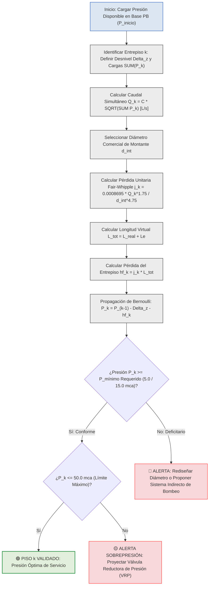

# PRESIONES EDIFICIOS

# MEMORIA TÉCNICA Y PROCEDIMIENTO DE INGENIERÍA PARA EL CÁLCULO DE PRESIONES PIEZOMÉTRICAS POR PISO EN EDIFICACIONES

En el diseño y dimensionamiento de redes interiores de distribución de agua potable a presión para edificaciones multifamiliares o institucionales en altura, la determinación de la presión piezométrica residual en cada nivel topográfico constituye el análisis hidráulico fundamental para verificar la estabilidad de servicio, comprobar la suficiencia del suministro directo o indirecto y prevenir sobrepresiones o fallas de cavitación.

---

## 1. FUNDAMENTACIÓN FÍSICA Y PRINCIPIO DE BERNOULLI

El cálculo piezométrico piso a piso se fundamenta en la aplicación del **Principio de Conservación de la Energía de Bernoulli** modificado por disipaciones irreversibles de energía. A medida que el agua potable asciende a través de la columna montante vertical desde la base en Planta Baja hacia los niveles superiores, experimenta dos mecanismos simultáneos de reducción de energía hidráulica:

1. **Pérdida de Carga Estática Geométrica ((\Delta z))**: Representa el trabajo realizado contra la fuerza de gravedad para elevar la masa de agua a través de la altura de entrepiso. Cada metro de elevación vertical consume exactamente (1.00 \text{ m c.a.}) de presión manométrica.
2. **Pérdida de Carga Dinámica por Rozamiento ((h_{\text{f}}))**: Representa la disipación de energía en forma de calor provocada por la fricción viscosa continua contra las paredes interiores del tubo de PVC y la turbulencia localizada producida por los accesorios de interconexión (tees, codos, reducciones y válvulas).

---

## 2. FORMULACIÓN MATEMÁTICA Y ECUACIONES DEL MODELO

Para resolver la línea de energía piezométrica a lo largo de la columna montante, se ejecuta la siguiente secuencia de fórmulas analíticas en el Sistema Internacional (SI):

### 2.1 Caudal Simultáneo Máximo Probable por Tramo (Método de Hunter Simplificado)

El caudal volumétrico que circula por cada tramo vertical se evalúa a partir de la sumatoria de las Unidades de Gasto ((\sum P)) de los aparatos sanitarios alimentados aguas arriba:

[ Q_k = C \cdot \sqrt{\sum P_k} ]

Donde:

- **(Q_k)**: Caudal simultáneo máximo probable de diseño que transita por el tramo de montante del piso (k), en L/s.
- **(C)**: Coeficiente empírico de simultaneidad global de la red a presión, fijado normativamente en (0.25 \text{ L/s}) por la norma NEC-11.
- **(\sum P_k)**: Sumatoria acumulada de Unidades de Gasto o pesos de Hunter de los aparatos sanitarios servidos desde el piso (k) hasta el nivel superior, adimensional.

---

### 2.2 Pérdida de Carga Unitaria por Fricción (Ecuación de Fair-Whipple-Hsiao)

Para determinar el gradiente de disipación continua por metro lineal en tuberías plásticas de PVC a 20 °C, se aplica la formulación oficial SSOT:

[ j_k = 0.0008695 \cdot \frac{Q_k^{1.75}}{d_{\text{int, } k}^{4.75}} ]

Donde:

- **(j_k)**: Pérdida de carga unitaria por fricción a lo largo del tramo vertical (k), en m c.a./m.
- **(0.0008695)**: Constante empírica oficial para agua fría en tuberías de superficie pulida de PVC.
- **(Q_k)**: Caudal volumétrico de diseño que transita por el tramo (k), en m³/s.
- **(d_{\text{int, } k})**: Diámetro interior real de la tubería plástica seleccionada en catálogo para el tramo (k), en m.

---

### 2.3 Longitud Total de Cálculo del Tramo

La longitud virtual del tramo incorpora la adición de metros equivalentes provocados por accesorios:

[ L_{\text{total, } k} = L_{\text{real, } k} + L_{\text{e, } k} ]

Donde:

- **(L_{\text{total, } k})**: Longitud virtual o total de cálculo para el tramo de entrepiso (k), en m.
- **(L_{\text{real, } k})**: Longitud física rectilínea del entrepiso (k), en m.
- **(L_{\text{e, } k})**: Longitud equivalente producida por pérdidas localizadas en tees de derivación, codos y válvulas en el tramo (k), en m.

---

### 2.4 Pérdida de Carga del Tramo

La caída de presión generada por rozamiento en el segmento vertical (k) se calcula mediante:

[ h_{\text{f, } k} = j_k \cdot L_{\text{total, } k} ]

Donde:

- **(h_{\text{f, } k})**: Pérdida de carga hidráulica disipada en el tramo vertical (k), en m c.a.
- **(j_k)**: Pérdida de carga unitaria por fricción calculada para el tramo (k), en m c.a./m.
- **(L_{\text{total, } k})**: Longitud virtual o total de cálculo del tramo (k), en m.

---

### 2.5 Balance Piezométrico Recurrente por Entrepiso

La presión manométrica disponible a la llegada de la subred o colector del piso (k) se evalúa restando las pérdidas del tramo y el desnivel al piso inferior (k-1):

[ P_k = P_{k-1} - \Delta z_{(k-1 \rightarrow k)} - h_{\text{f, } (k-1 \rightarrow k)} ]

Donde:

- **(P_k)**: Presión manométrica piezométrica resultante disponible a la entrada del piso (k), en m c.a..
- **(P_{k-1})**: Presión manométrica piezométrica calculada a la entrada del piso inmediatamente inferior (k-1), en m c.a..
- **(\Delta z_{(k-1 \rightarrow k)})**: Desnivel geométrico o diferencia de cota topográfica vertical entre el piso (k) y el piso (k-1), en m.
- **(h_{\text{f, } (k-1 \rightarrow k)})**: Pérdida de carga hidráulica acumulada por fricción y accesorios en la montante entre el piso (k-1) y el piso (k), en m c.a..

---

### 2.6 Balance Piezométrico Global desde la Base

Alternativamente, la presión en cualquier piso (k) se calcula a partir de la presión inicial en la base en Planta Baja:

[ P_k = P_{\text{inicio}} - \Delta z_{\text{acum, } k} - \sum_{i=1}^{k} h_{\text{f, } i} ]

Donde:

- **(P_k)**: Presión manométrica piezométrica disponible a la entrada del piso (k), en m c.a..
- **(P_{\text{inicio}})**: Presión piezométrica disponible a la salida del medidor contador o equipo de presurización en Planta Baja, en m c.a..
- **(\Delta z_{\text{acum, } k})**: Cota de elevación vertical acumulada desde el nivel de referencia en Planta Baja hasta el piso (k), en m.
- **(\sum_{i=1}^{k} h_{\text{f, } i})**: Sumatoria de pérdidas de carga por fricción y accesorios acumuladas en la columna montante desde la base hasta el piso (k), en m c.a..

---

## 3. PROCEDIMIENTO SECUENCIAL DE CÁLCULO EN 5 ETAPAS

Para ejecutar la memoria hidráulica de presiones en una edificación de **(N)** pisos, el proyectista o motor de software sigue el siguiente procedimiento ordenado:

1. **Paso 1 (Determinación de la Presión Inicial (P_{\text{inicio}}))**: Se toma la presión garantizada en la red pública municipal ((P_{\text{matriz}})) y se descuentan las caídas de presión de la acometida ((J_{\text{acometida}})) y del cuerpo del medidor contador ((J_{\text{medidor}})).
2. **Paso 2 (Inventario y Cargas por Nivel)**: Se tabulan los aparatos sanitarios servidos por piso y se acumulan sus pesos de Hunter ((\sum P_k)) en sentido descendente de flujo.
3. **Paso 3 (Dimensionamiento Cinemático de Montante)**: Se asignan los diámetros comerciales verificando que la velocidad real se mantenga dentro de los límites de confort ((V \le 2.00 \text{ m/s})) y respetando el Criterio de Telescopía de la NEC-11 (el diámetro inferior debe ser igual o mayor al superior).
4. **Paso 4 (Cómputo de Pérdidas Continuas y Localizadas)**: Se calculan el gradiente (j_k) con la ecuación de Fair-Whipple-Hsiao y las pérdidas del entrepiso (h_{\text{f, } k}).
5. **Paso 5 (Deducción Piezométrica y Verificación Normativa)**: Se resta la pérdida de carga y la cota de entrepiso ((\Delta z)) a la presión del nivel anterior, evaluando el cumplimiento de las presiones residuales mínimas y máximas.

---

## 4. CUADROS TÉCNICOS Y EJEMPLO DE BALANCE PIEZOMÉTRICO

### Cuadro 1: Ejemplo de Balance Piezométrico Ascendente en Edificio Multifamiliar de 4 Niveles

| Nivel / Piso ((k)) | Cota Altimétrica (z_k) (m) | Carga Servida (\sum P_k) (UM) | Caudal (Q_k) (L/s) | Diámetro Asumido | Velocidad Real (V_k) (m/s) | Loss Unit (j_k) (mca/m) | Desnivel (\Delta z) (m) | Loss Tramo (h_{\text{f, } k}) (mca) | Loss Acum (\sum h_{\text{f}}) (mca) | Presión Entrada Piso (P_k) (mca) | Estado Piezométrico |
|:---|:---:|:---:|:---:|:---:|:---:|:---:|:---:|:---:|:---:|:---:|:---|
| **Salida Medidor PB** | **0.00 m** | **19.00 UM** | **1.090 L/s** | **1 1/4" (32 mm)** | 1.25 m/s | 0.059 mca/m | 0.00 m | 0.000 mca | 0.000 mca | **26.02 m c.a.** | 🟢 Punto de Partida (P_{\text{inicio}}) |
| **Piso 0 (Planta Baja)** | **0.00 m** | **19.00 UM** | **1.090 L/s** | **1 1/4" (32 mm)** | 1.25 m/s | 0.059 mca/m | 0.00 m | 0.040 mca | 0.040 mca | **25.98 m c.a.** | 🟢 **CONFORME SOBRADO** ((> 15.0 \text{ mca})) |
| **Piso 1** | **3.06 m** | **12.00 UM** | **0.866 L/s** | **1 1/4" (32 mm)** | 0.99 m/s | 0.040 mca/m | +3.06 m | 0.220 mca | 0.260 mca | **22.70 m c.a.** | 🟢 **CONFORME CALEFÓN** ((> 15.0 \text{ mca})) |
| **Piso 2** | **6.12 m** | **8.00 UM** | **0.707 L/s** | **1 1/4" (32 mm)** | 0.81 m/s | 0.028 mca/m | +3.06 m | 0.175 mca | 0.435 mca | **19.47 m c.a.** | 🟢 **CONFORME CALEFÓN** ((> 15.0 \text{ mca})) |
| **Piso 3** | **9.18 m** | **4.00 UM** | **0.500 L/s** | **1 1/4" (32 mm)** | 0.57 m/s | 0.015 mca/m | +3.06 m | 0.180 mca | 0.615 mca | **16.23 m c.a.** | 🟢 **CUMPLE CALEFÓN** ((> 15.0 \text{ mca})) |

---

### Cuadro 2: Umbrales Normativos de Control Piezométrico en Nudos de Consumo

| Parámetro Hidráulico | Valor Límité Normativo | Efecto Físico de Vulneración | Medida de Corrección de Ingeniería |
|:---|:---:|:---|:---|
| **Presión Mínima Grifería Estándar** | **(\ge 5.00 \text{ m c.a.})** | Caudal insuficiente y llenado lento de piezas sanitarias. | Incrementar diámetro de montante o instalar equipo de presurización. |
| **Presión Mínima Encendido Calefón** | **(\ge 15.00 \text{ m c.a.})** | Apagado automático de la membrana de gas; falta de agua caliente. | Elevar presión inicial con sistema hidroneumático o variador. |
| **Presión Mínima Fluxómetros** | **(\ge 10.00 \text{ a } 15.00 \text{ m c.a.})** | Incapacidad de arrastre en inodoros de descarga rápida. | Diseñar red independiente con tanque hidroacumulador. |
| **Presión Máxima Admisible Nudos** | **(\le 50.00 \text{ m c.a.})** | Daño en empaques, ruido por cavitación y desgaste de grifería. | Instalar válvulas reductoras de presión (VRP) o zonificar la red. |

---

## 5. DIAGRAMA LÓGICO DE CÁLCULO PIEZOMÉTRICO EN MERMAID

El siguiente flujograma de ingeniería describe la secuencia analítica para el cálculo de presiones por piso, utilizando trazados 
ortogonales y la paleta de colores normada:

## 6. CONCLUSIONES Y RECOMENDACIONES DE INGENIERÍA

1. **Rigor del Balance Continuo**: La presión en los pisos no se estima mediante proporciones fijas, sino deduciendo analíticamente la cota topográfica ((\Delta z)) y las pérdidas por fricción acumuladas ((\sum h_{\text{f}})) a partir de la presión inicial en la base.
2. **Control de Presiones Extremas**: Se debe asegurar que el piso más alto disponga de al menos (15.00 \text{ m c.a.}) para abastecer calentadores de paso a gas, mientras que los pisos inferiores en edificios de gran altura no deben rebasar los (50.00 \text{ m c.a.}) para proteger la grifería.
3. **Criterio de Suministro**: Si el balance en el último piso resulta inferior a (5.00 \text{ m c.a.}), la red debe declararse no conforme para suministro directo y se debe proyectar un sistema indirecto de presurización (hidroneumático o equipo de velocidad variable).

---

## REFERENCIAS TÉCNICAS

Ministerio de Desarrollo Urbano y Vivienda. (2011). *Norma Ecuatoriana de la Construcción NEC-11: Capítulo 16 NHE Agua (Norma Hidrosanitaria de Agua Potable y Evacuación de Desechos)*. MIDUVI.

Pérez Carmona, R. (2018). *Instalaciones hidrosanitarias, de gas y de aprovechamiento de aguas lluvias en edificaciones*. 8va Edición, Ediciones de la U.

Macintyre, A. J. (2010). *Manual de Instalações Hidráulicas e Sanitárias*. Editora Guanabara Dois.

Larriva, Ing. (2026). *Memoria de Cálculo Hidrosanitaria AF-SR y Tratado de Ingeniería Hidrosanitaria*.

Empresa Pública Municipal de Agua Potable y Alcantarillado de Cuenca. (2020). *Guía para la Selección de Medidores Domiciliarios de Agua Potable y Especificaciones Técnicas*. ETAPA EP.

---

💧 *Esta explicación metodológica proporciona el sustento teórico, la formulación matemática en LaTeX y las tablas de control necesarias para fundamentar cualquier memoria de cálculo o simulación de presiones por piso.*
