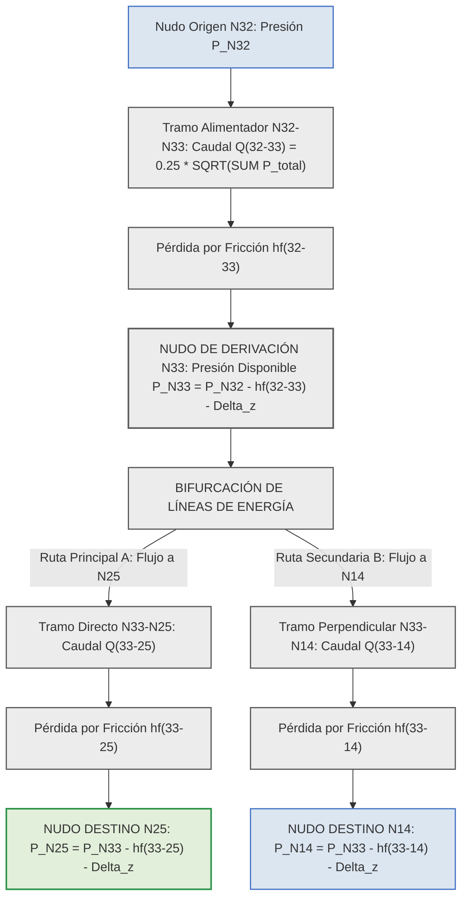

# INFORME TÉCNICO DE INGENIERÍA HIDRÁULICA: EVALUACIÓN DE PÉRDIDAS DE CARGA ACUMULADAS Y PROPAGACIÓN ENERGÉTICA EN NUDOS CON DERIVACIONES EN REDES A PRESIÓN

En el diseño y dimensionamiento analítico de redes de distribución de agua potable a presión en edificaciones, la determinación exacta de las presiones piezométricas residuales y la pérdida de carga acumulada en cada nudo de consumo exige aplicar de manera rigurosa el Principio de Conservación de la Energía de Bernoulli a lo largo de la trayectoria física real del fluido.

A continuación, se presenta la evaluación técnica detallada para resolver el cálculo de pérdidas acumuladas en el nudo **N25** perteneciente a la conducción principal **N32-N33-N25-N31**, considerando la derivación perpendicular **N33-N14** en el nudo **N33**.

---

## 1. DICTAMEN TÉCNICO Y EVALUACIÓN DE CRITERIOS

**El Criterio A (Criterio 1) es el ÚNICO físicamente correcto y normativamente aceptado.**

Para calcular la pérdida de carga acumulada y la presión piezométrica disponible en el nudo **N25**, se deben sumar **únicamente** las pérdidas por fricción continua y las pérdidas localizadas por accesorios de los tramos que componen la ruta física del agua desde el origen hasta dicho punto, es decir: **N32-N33** más **N33-N25**.

**Se debe excluir taxativamente la pérdida de carga del tramo derivado N33-N14**.

---

## 2. FUNDAMENTACIÓN FÍSICA Y TERMODINÁMICA

La justificación teórica de por qué el **Criterio A** es el correcto y el **Criterio B** constituye un error conceptual grave se fundamenta en los siguientes tres principios hidráulicos:

### 2.1 Unicidad del Estado Piezométrico en el Nudo Confluencia (N33)
El nudo **N33** representa un punto geométrico y topológico continuo donde el agua posee una **única carga piezométrica disponible** (\\(H_{\text{N33}}\\)). La energía en el nudo N33 depende exclusivamente del flujo proveniente de N32 menos la pérdida disipada en el tramo N32-N33:

\\[P_{\text{N33}} = P_{\text{N32}} - h_{\text{f, (N32-N33)}} - \Delta z_{\text{(N32-N33)}}\\]

* **\\(P_{\text{N33}}\\)**: Presión manométrica piezométrica disponible en el nudo de intersección N33, expresada en metros de columna de agua (\\(\text{m c.a.}\\)).
* **\\(P_{\text{N32}}\\)**: Presión manométrica piezométrica inicial en el nudo alimentador N32, expresada en metros de columna de agua (\\(\text{m c.a.}\\)).
* **\\(h_{\text{f, (N32-N33)}}\\)**: Pérdida de carga hidráulica por fricción y accesorios en el tramo N32-N33, expresada en metros de columna de agua (\\(\text{m c.a.}\\)).
* **\\(\Delta z_{\text{(N32-N33)}}\\)**: Diferencia de cota topográfica entre el nudo N33 y el nudo N32 (\\(z_{\text{N33}} - z_{\text{N32}}\\)), expresada en metros (\\(\text{m}\\)).

### 2.2 Propagación Piezométrica Independiente por Trayectoria Física
A partir del nudo N33, el caudal se bifurca en dos trayectorias independientes:
1. **Línea Principal (N33 \\(\rightarrow\\) N25):** Las partículas de agua que circulan hacia N25 solo rozan las paredes internas de la tubería del tramo N33-N25 y sus accesorios directos.
2. **Derivación Perpendicular (N33 \\(\rightarrow\\) N14):** Las partículas de agua que derivan hacia N14 circulan por la tubería N33-N14.

El agua que llega al nudo N25 **nunca transitó por la tubería N33-N14**. Por lo tanto, la fricción producida dentro del tramo N33-N14 no puede restar energía a una masa de agua que circula por una tubería completamente distinta.

### 2.3 Imposibilidad Física del Criterio B
Sumar la pérdida del tramo N33-N14 al cálculo de N25 asumiría hipotéticamente que el agua viaja de N32 a N33, ingresa a la derivación N14, pierde energía por fricción allí, y luego se devuelve a N33 para continuar su camino hacia N25. Esta suposición viola el Teorema de Bernoulli y el Principio de Conservación de la Energía, introduciendo una pérdida de carga ficticia que falsearía el diseño y daría presiones negativas irreales en el sistema.

---

## 3. FORMULACIÓN MATEMÁTICA CORRECTA PARA EL NUDO N25

Para determinar la pérdida acumulada y la presión piezométrica en el nudo N25, la aplicación o memoria técnica debe resolver las siguientes ecuaciones analíticas:

### 3.1 Pérdida de Carga Acumulada en la Ruta Crítica hacia N25
La pérdida de energía acumulada por fricción y accesorios desde el origen hasta el nudo N25 se define como:

\\[h_{\text{f, acum (N25)}} = h_{\text{f, (N32-N33)}} + h_{\text{f, (N33-N25)}}\\]

* **\\(h_{\text{f, acum (N25)}}\\)**: Pérdida de carga hidráulica acumulada por fricción continua y localizada a lo largo de la trayectoria hacia el nudo N25, expresada en metros de columna de agua (\\(\text{m c.a.}\\)).
* **\\(h_{\text{f, (N32-N33)}}\\)**: Pérdida de carga hidráulica por fricción y accesorios disipada en el tramo alimentador N32-N33, expresada en metros de columna de agua (\\(\text{m c.a.}\\)).
* **\\(h_{\text{f, (N33-N25)}}\\)**: Pérdida de carga hidráulica por fricción y accesorios disipada en el tramo principal N33-N25, expresada en metros de columna de agua (\\(\text{m c.a.}\\)).

---

### 3.2 Presión Piezométrica Residual en el Nudo N25
La presión manométrica disponible a la llegada del nudo N25 se evalúa mediante:

\\[P_{\text{N25}} = P_{\text{N32}} - h_{\text{f, acum (N25)}} - \Delta z_{\text{(N32-N25)}}\\]

* **\\(P_{\text{N25}}\\)**: Presión manométrica piezométrica resultante disponible en el nudo N25, expresada en metros de columna de agua (\\(\text{m c.a.}\\)).
* **\\(P_{\text{N32}}\\)**: Presión manométrica piezométrica inicial disponible en el nudo de origen N32, expresada en metros de columna de agua (\\(\text{m c.a.}\\)).
* **\\(h_{\text{f, acum (N25)}}\\)**: Pérdida de carga acumulada calculada para la trayectoria del flujo hacia el nudo N25, expresada en metros de columna de agua (\\(\text{m c.a.}\\)).
* **\\(\Delta z_{\text{(N32-N25)}}\\)**: Desnivel geométrico o diferencia de cota vertical entre el nudo N25 y el nudo N32 (\\(z_{\text{N25}} - z_{\text{N32}}\\)), expresado en metros (\\(\text{m}\\)).

---

### 3.3 Influencia Indirecta de la Derivación N33-N14 (Caudal Acumulado)
Aunque la pérdida por fricción del tubo N33-N14 se excluye en el cálculo de N25, la derivación N33-N14 **sí influye en la pérdida del tramo N32-N33** a través del caudal simultáneo:

\\[Q_{\text{(N32-N33)}} = C \cdot \sqrt{\sum P_{\text{(N33-N25)}} + \sum P_{\text{(N33-N14)}}}\\]

* **\\(Q_{\text{(N32-N33)}}\\)**: Caudal simultáneo de diseño que transita por el tramo alimentador N32-N33, expresado en litros por segundo (\\(\text{L/s}\\)).
* **\\(C\\)**: Coeficiente empírico de simultaneidad hidráulica de la red, fijado normativamente en \\(0.25 \text{ L/s}\\).
* **\\(\sum P_{\text{(N33-N25)}}\\)**: Sumatoria acumulada de Unidades de Gasto de los aparatos servidos aguas abajo de la línea N33-N25, adimensional.
* **\\(\sum P_{\text{(N33-N14)}}\\)**: Sumatoria acumulada de Unidades de Gasto de los aparatos servidos aguas abajo de la derivación N33-N14, adimensional.

El tramo N32-N33 transporta el caudal total de ambas ramas. Ese mayor caudal incrementa la velocidad y el gradiente de fricción (\\(j\\)) en N32-N33. Sin embargo, una vez alcanzado el nudo N33, la disipación del tubo N33-N14 pertenece exclusivamente al ramal N14.

---

## 4. CUADROS TÉCNICOS COMPARATIVOS Y ASIGNACIÓN DE ACCESORIOS

### Cuadro 1: Matriz Comparativa de Criterios de Acumulación para el Nudo N25

| Parámetro / Criterio | Criterio A (Correcto: Ruta Física N32-N33-N25) | Criterio B (Incorrecto: Inclusión N33-N14) | Dictamen y Diagnóstico de Ingeniería |
| :--- | :--- | :--- | :--- |
| **Trayectoria Evaluada** | N32 \\(\rightarrow\\) N33 \\(\rightarrow\\) N25. | N32 \\(\rightarrow\\) N33 \\(\rightarrow\\) N14 \\(\rightarrow\\) N25 (Camino irreal). | **OBLIGATORIO:** Respetar la ruta física del flujo. |
| **Fórmula de Pérdida** | \\(h_{\text{f, acum}} = h_{\text{f(32-33)}} + h_{\text{f(33-25)}}\\). | \\(h_{\text{f, acum}} = h_{\text{f(32-33)}} + h_{\text{f(33-14)}} + h_{\text{f(33-25)}}\\). | Criterio B distorsiona la línea de energía. |
| **Efecto de la Derivación** | Influye solo en el caudal \\(Q\\) de N32-N33. | Suma pérdidas de tubos por donde no pasa agua. | Criterio B provoca caídas de presión irreales. |
| **Presión Piezométrica** | Calcula la presión física real disponible. | Subestima la presión en N25 (falso negativo). | Criterio A es el único homologado normativamente. |

---

### Cuadro 2: Asignación de Longitud Equivalente por Accesorios (\\(L_{\text{e}}\\)) en la Confluencia N33

| Tramo de Conducción | Tipo de Accesorio Instalado en N33 | Relación \\(L_{\text{e}}/D\\) Asignada | Criterio de Turbulencia Localizada |
| :--- | :--- | :---: | :--- |
| **Tramo N33-N25 (Línea Directa)** | Tee PVC Paso Directo (Flujo rectilíneo) | **10.00** | Menor turbulencia por flujo directo a través del tronco. |
| **Tramo N33-N14 (Derivación)** | Tee PVC Salida Lateral (Flujo a 90°) | **60.00** | Mayor disipación localizada por cambio de dirección. |

---

## 5. DIAGRAMA LÓGICO DE PROPAGACIÓN DE ENERGÍA Y FLUJO (MERMAID)

El siguiente esquema en Mermaid describe la propagación piezométrica independiente a partir del nudo de distribución N33, utilizando la paleta de colores normada (sin fondos amarillos):

---

## FUENTES Y REFERENCIAS CITADAS

* Ministerio de Desarrollo Urbano y Vivienda (MIDUVI). *Norma Ecuatoriana de la Construcción NEC-11: Capítulo 16 NHE Agua*. Quito, Ecuador.
* Macintyre, Archibald Joseph. *Manual de Instalações Hidráulicas e Sanitárias*. Editora Guanabara Dois, Rio de Janeiro, Brasil.
* Larriva, Ing. *Memoria de Cálculo Hidrosanitaria AF-SR y Tratado de Ingeniería Hidrosanitaria*. Cuenca, Ecuador.
* Bustamante Carbo, Gino. *Seminario de Diseño Hidrosanitario 2: Estructuración de Redes y Balance de Presiones*. Conferencia Técnica.

---

💡 **Recomendación para la programación de la App:** En el algoritmo de cálculo (`pressureEngine.ts`), asegúrate de que la función que calcula las pérdidas acumuladas busque la **ruta del camino más corto o árbol de expansión (Dijkstra/DAG)** desde el nodo raíz hasta el nodo de destino, sumando únicamente los tramos pertenecientes a esa ruta lineal. Jamás debes iterar sobre ramas laterales adyacentes al evaluar un nodo de destino específico.
