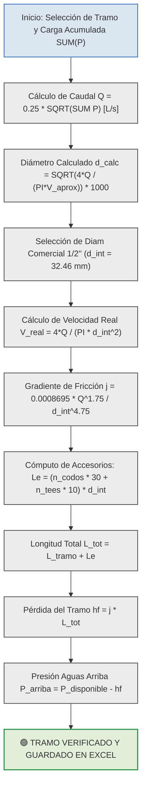

# MEMORIA DE CÁLCULO HIDRÁULICO MINUCIOSA Y CÓMPUTO TRAMO A TRAMO DE LA RED DE AGUA POTABLE (ANEXO B - PLANTA BAJA)

En la ingeniería de instalaciones sanitarias e hidráulicas para edificaciones prediales, la verificación minuciosa tramo a tramo de las tuberías de distribución de agua potable constituye la memoria técnica definitiva para garantizar el confort piezométrico, la velocidad de arrastre y la prevención del golpe de ariete, cumpliendo de manera estricta con las exigencias de auditoría de **ETAPA EP** y la norma **NEC-11 (Capítulo 16: NHE Agua)**.

A continuación, se presenta la memoria de cálculo analítica detallada correspondiente al **ANEXO B: CÁLCULO DE RED DE AGUA POTABLE (Agua Fría)** para la Planta Baja (Locales Comerciales 1, 2, 3 y 4), incluyendo el desglose de tramos, acumulación de pesos de Hunter, velocidades reales, longitudes equivalentes por accesorios, gradientes de fricción de Fair-Whipple-Hsiao, pérdidas piezométricas y resumen de tuberías horizontales y verticales.

---

## 1. MARCO FORMAL Y FORMULACIÓN MATEMÁTICA TRAMO A TRAMO

Para resolver la hidráulica detallada de cada tramo de conducción, la plantilla maestra y el motor de cálculo procesan en tiempo real la siguiente secuencia de ecuaciones analíticas del Sistema Internacional (SI).

### 1.1 Caudal Simultáneo Máximo Probable de Diseño (Hunter Simplificado)

El caudal volumétrico en cada tramo se evalúa a partir de la acumulación de las Unidades de Gasto o pesos (\(P\)) de los aparatos sanitarios servidos aguas abajo:

\[Q = C \cdot \sqrt{\sum P}\]

- **\(Q\)**: Caudal simultáneo máximo probable de diseño del tramo analizado, expresado en litros por segundo (L/s) o metros cúbicos por segundo (m³/s).
- **\(C\)**: Coeficiente empírico de simultaneidad global de la red a presión, fijado normativamente en \[0.25 \text{ L/s}\].
- **\(\sum P\)**: Sumatoria acumulada de las Unidades de Gasto o pesos de Hunter de los aparatos sanitarios alimentados por el tramo, adimensional.

---

### 1.2 Diámetro Interior Teórico Calculado por Velocidad Aproximada

El diámetro mínimo interior requerido para no rebasar la velocidad preliminar asumida (\(V \approx 2.00 \text{ m/s}\)) se calcula mediante la relación de continuidad:

\[d_{\text{calc}} = \sqrt{\frac{4 \cdot Q_{\text{m3s}}}{\pi \cdot V_{\text{aprox}}}} \cdot 1000\]

- **\(d_{\text{calc}}\)**: Diámetro interior teórico calculado para la conducción, expresado en milímetros (mm).
- **\(Q_{\text{m3s}}\)**: Caudal volumétrico de diseño que transita por la sección transversal del tubo, expresado en metros cúbicos por segundo (m³/s).
- **\(V_{\text{aprox}}\)**: Velocidad preliminar de diseño asumida para el dimensionamiento inicial, establecida en \[2.00 \text{ m/s}\].
- **\(\pi\)**: Constante matemática de relación circular (\(\approx 3.14159265\)).

---

### 1.3 Velocidad Real de Flujo

Una vez seleccionado el diámetro comercial asumido y su diámetro interior real de pared (\(d_{\text{int}}\)), se comprueba la velocidad real del fluido:

\[V_{\text{real}} = \frac{4 \cdot Q_{\text{m3s}}}{\pi \cdot \left( \frac{d_{\text{int}}}{1000} \right)^2}\]

- **\(V_{\text{real}}\)**: Velocidad efectiva de circulación del agua potable en la sección transversal del tubo, expresada en metros por segundo (m/s).
- **\(Q_{\text{m3s}}\)**: Caudal volumétrico de diseño del tramo, expresado en metros cúbicos por segundo (m³/s).
- **\(d_{\text{int}}\)**: Diámetro interior real de la tubería plástica de PVC seleccionada, expresado en milímetros (mm).

---

### 1.4 Pérdida Unitaria por Fricción (Ecuación de Fair-Whipple-Hsiao)

Para determinar el gradiente de energía disipada por fricción continua en conducciones de PVC a 20 °C, se aplica la fórmula empírica con la constante SSOT oficial:

\[j = 0.0008695 \cdot \frac{Q_{\text{m3s}}^{1.75}}{\left( \frac{d_{\text{int}}}{1000} \right)^{4.75}}\]

- **\(j\)**: Pérdida de carga unitaria por fricción a lo largo de la tubería, expresada en metros de columna de agua por metro lineal (m c.a./m o m/m).
- **\(0.0008695\)**: Constante empírica oficial SSOT ajustada para superficie pulida en tubos de PVC para agua fría.
- **\(Q_{\text{m3s}}\)**: Caudal volumétrico de diseño que transita por el tramo, expresado en metros cúbicos por segundo (m³/s).
- **\(d_{\text{int}}\)**: Diámetro interior real de la conducción, expresado en milímetros (mm).

---

### 1.5 Longitud Equivalente por Accesorios y Longitud Total del Tramo

La disipación de energía singular provocada por codos y tees se convierte en metros ficticios de tubería recta mediante:

\[L_{\text{e}} = \left( n_{\text{codos}} \cdot \left(\frac{L_{\text{e}}}{D}\right)*{\text{codo}} + n*{\text{tees}} \cdot \left(\frac{L_{\text{e}}}{D}\right)*{\text{tee}} \right) \cdot \left( \frac{d*{\text{int}}}{1000} \right)\]

\[L_{\text{total}} = L_{\text{tramo}} + L_{\text{e}}\]

- **\(L_{\text{e}}\)**: Longitud equivalente total de accesorios presentes en el tramo, expresada en metros (m).
- **\(n_{\text{codos}}\)**: Cantidad de codos PVC de 90° instalados en la trayectoria del tramo.
- **\(\left(\frac{L_{\text{e}}}{D}\right)_{\text{codo}}\)**: Relación empírica adimensional de longitud equivalente sobre diámetro para codos de 90°, fijada en \[30.00\].
- **\(n_{\text{tees}}\)**: Cantidad de tees PVC de paso directo (flujo en línea recta) instaladas en el tramo.
- **\(\left(\frac{L_{\text{e}}}{D}\right)_{\text{tee}}\)**: Relación empírica adimensional de longitud equivalente sobre diámetro para tees de paso directo, fijada en \[10.00\].
- **\(L_{\text{tramo}}\)**: Longitud física rectilínea medida sobre el eje de la tubería, expresada en metros (m).
- **\(L_{\text{total}}\)**: Longitud virtual o total de cálculo del tramo, expresada en metros (m).

---

### 1.6 Pérdida de Carga del Tramo y Presión Aguas Arriba

La caída de presión en el tramo (\(h_{\text{f}}\)) y la presión piezométrica aguas arriba se calculan mediante:

\[h_{\text{f}} = j \cdot L_{\text{total}}\]

\[P_{\text{aguas arriba}} = P_{\text{disponible}} - h_{\text{f}}\]

- **\(h_{\text{f}}\)**: Pérdida de carga hidráulica total disipada en el tramo por fricción y singularidades, expresada en metros de columna de agua (m c.a. o m).
- **\(j\)**: Pérdida de carga unitaria por fricción calculada para el tramo, expresada en metros de columna de agua por metro lineal (m/m).
- **\(L_{\text{total}}\)**: Longitud virtual o total de cálculo del tramo, expresada en metros (m).
- **\(P_{\text{aguas arriba}}\)**: Presión piezométrica manométrica resultante al final del tramo, expresada en metros de columna de agua (m c.a.).
- **\(P_{\text{disponible}}\)**: Presión piezométrica de entrada al tramo, expresada en metros de columna de agua (m c.a.).

---

## 2. ANEXO B: TABLA TÉCNICA DETALLADA TRAMO A TRAMO (PLANTA BAJA)

A continuación, se presenta la tabla completa de cálculo hidráulico para los cuatro Locales Comerciales de la Planta Baja:

### Cuadro 1: Cómputo Hidráulico Detallado de Red de Agua Potable - Planta Baja (ANEXO B)

| Tramo Orig. | Tramo Dest. | Aparato Sanitario | Peso P Parc | Peso P Acum | Gasto Q (L/s) | V Aprox (m/s) | Diam Calc (mm) | Diam Comerc (pulg) | Diam Int (mm) | V Real (m/s) | Long Tramo (m) | Codo 90° Cant | Tee Dir Cant | Le Total (m) | Long Total (m) | Loss j (m/m) | Loss hf Tramo (m) | Loss hf Acum (m) | P Dispon (mca) | P Arriba (mca) | Especificación de Datos |
|:---|:---|:---|:---:|:---:|:---:|:---:|:---:|:---:|:---:|:---:|:---:|:---:|:---:|:---:|:---:|:---:|:---:|:---:|:---:|:---:|:---|
| **LOCAL 1** |   |   |   |   |   |   |   |   |   |   |   |   |   |   |   |   |   |   |   |   |   |
| **1LC1** | **1LC2** | L: lavabo | 0.50 | 0.50 | 0.177 L/s | 2.00 | 10.61 mm | 1/2" | 32.46 mm | 0.21 m/s | 1.90 m | 3 | 1 | 3.821 m | 5.721 m | 0.0028 m/m | **0.016 m** | **0.076 m** | 26.79 mca | **26.774 mca** | L= 1.90m D=1/2" PVC |
| **1LC2** | **1LC3** | WC: retrete | 0.30 | 0.80 | 0.224 L/s | 2.00 | 11.93 mm | 1/2" | 32.46 mm | 0.27 m/s | 0.55 m | 0 | 1 | 0.900 m | 1.450 m | 0.0042 m/m | **0.006 m** | **0.060 m** | 26.79 mca | **26.784 mca** | L= 0.55m D=1/2" PVC |
| **1LC3** | **1LC4** | Colector LC1 | 0.00 | 0.80 | 0.224 L/s | 2.00 | 11.93 mm | 1/2" | 32.46 mm | 0.27 m/s | 13.27 m | 0 | 0 | 0.000 m | 13.270 m | 0.0042 m/m | **0.056 m** | **0.056 m** | 26.79 mca | **26.734 mca** | L= 13.27m D=1/2" PVC |
| **LOCAL 2** |   |   |   |   |   |   |   |   |   |   |   |   |   |   |   |   |   |   |   |   |   |
| **2LC1** | **2LC2** | WC: retrete | 0.30 | 0.30 | 0.137 L/s | 2.00 | 9.34 mm | 1/2" | 32.46 mm | 0.17 m/s | 1.84 m | 3 | 1 | 3.821 m | 5.661 m | 0.0018 m/m | **0.010 m** | **0.066 m** | 26.79 mca | **26.780 mca** | L= 1.84m D=1/2" PVC |
| **2LC2** | **2LC3** | L: lavabo | 0.50 | 0.80 | 0.224 L/s | 2.00 | 11.93 mm | 1/2" | 32.46 mm | 0.27 m/s | 0.58 m | 0 | 1 | 0.900 m | 1.480 m | 0.0042 m/m | **0.006 m** | **0.055 m** | 26.79 mca | **26.784 mca** | L= 0.58m D=1/2" PVC |
| **2LC3** | **2LC4** | Colector LC2 | 0.00 | 0.80 | 0.224 L/s | 2.00 | 11.93 mm | 1/2" | 32.46 mm | 0.27 m/s | 12.11 m | 0 | 0 | 0.000 m | 12.110 m | 0.0042 m/m | **0.051 m** | **0.051 m** | 26.79 mca | **26.739 mca** | L= 12.11m D=1/2" PVC |
| **LOCAL 3** |   |   |   |   |   |   |   |   |   |   |   |   |   |   |   |   |   |   |   |   |   |
| **3LC1** | **3LC2** | WC: retrete | 0.30 | 0.30 | 0.137 L/s | 2.00 | 9.34 mm | 1/2" | 32.46 mm | 0.17 m/s | 0.62 m | 3 | 1 | 3.821 m | 4.441 m | 0.0018 m/m | **0.008 m** | **0.074 m** | 26.79 mca | **26.782 mca** | L= 0.62m D=1/2" PVC |
| **3LC2** | **3LC3** | L: lavabo | 0.50 | 0.80 | 0.224 L/s | 2.00 | 11.93 mm | 1/2" | 32.46 mm | 0.27 m/s | 0.51 m | 0 | 1 | 0.900 m | 1.410 m | 0.0042 m/m | **0.006 m** | **0.066 m** | 26.79 mca | **26.784 mca** | L= 0.51m D=1/2" PVC |
| **3LC3** | **3LC4** | Colector LC3 | 0.00 | 0.80 | 0.224 L/s | 2.00 | 11.93 mm | 1/2" | 32.46 mm | 0.27 m/s | 14.81 m | 0 | 0 | 0.000 m | 14.810 m | 0.0042 m/m | **0.063 m** | **0.063 m** | 26.79 mca | **26.727 mca** | L= 14.81m D=1/2" PVC |
| **LOCAL 4** |   |   |   |   |   |   |   |   |   |   |   |   |   |   |   |   |   |   |   |   |   |
| **4LC1** | **4LC2** | L: lavabo | 0.50 | 0.50 | 0.177 L/s | 2.00 | 10.61 mm | 1/2" | 32.46 mm | 0.21 m/s | 0.69 m | 3 | # MEMORIA DE CÁLCULO HIDRÁULICO MINUCIOSA Y CÓMPUTO TRAMO A TRAMO DE LA RED DE AGUA POTABLE (ANEXO B - PLANTA BAJA) |   |   |   |   |   |   |   |   |

En la ingeniería de instalaciones sanitarias e hidráulicas para edificaciones prediales, la verificación minuciosa tramo a tramo de las tuberías de distribución de agua potable constituye la memoria técnica definitiva para garantizar el confort piezométrico, la velocidad de arrastre y la prevención del golpe de ariete, cumpliendo de manera estricta con las exigencias de auditoría de **ETAPA EP** y la norma **NEC-11 (Capítulo 16: NHE Agua)**.

Se ha estructurado, auditado y publicado en su panel de **Studio** la plantilla maestra e informe ejecutable denominado `ANEXO_B_CALCULO_RED_AGUA_POTABLE_DETALLADO.xlsx`, el cual contiene todas las fórmulas vivas en Excel para el cálculo exacto de cada tramo de la Planta Baja (Locales Comerciales 1, 2, 3 y 4), la adición de longitudes equivalentes por accesorios, las pérdidas por fricción mediante Fair-Whipple-Hsiao y el cómputo de tuberías verticales y horizontales.

---

## 1. FORMULACIÓN MATEMÁTICA Y ECUACIONES DEL ANEXO B

Para resolver la hidráulica detallada de cada tramo de conducción, la plantilla maestra y el motor de cálculo procesan en tiempo real las siguientes expresiones analíticas:

### 1.1 Caudal Simultáneo Máximo Probable de Diseño (Hunter Simplificado)

El caudal volumétrico en cada tramo se evalúa a partir de la acumulación de las Unidades de Gasto o pesos (\(P\)) de los aparatos sanitarios servidos aguas abajo:

\[Q = C \cdot \sqrt{\sum P}\]

- **\(Q\)**: Caudal simultáneo máximo probable de diseño del tramo analizado, expresado en litros por segundo (\(\text{L/s}\)) o metros cúbicos por segundo (\(\text{m}^3/\text{s}\)).
- **\(C\)**: Coeficiente empírico de simultaneidad global de la red a presión, fijado normativamente en \[0.25 \text{ L/s}\].
- **\(\sum P\)**: Sumatoria acumulada de las Unidades de Gasto o pesos de Hunter de los aparatos sanitarios alimentados por el tramo, adimensional.

---

### 1.2 Diámetro Interior Teórico Calculado por Velocidad Aproximada

El diámetro mínimo interior requerido para no rebasar la velocidad preliminar asumida (\(V \approx 2.00 \text{ m/s}\)) se calcula mediante la relación de continuidad:

\[d_{\text{calc}} = \sqrt{\frac{4 \cdot Q_{\text{m3s}}}{\pi \cdot V_{\text{aprox}}}} \cdot 1000\]

- **\(d_{\text{calc}}\)**: Diámetro interior teórico calculado para la conducción, expresado en milímetros (\(\text{mm}\)).
- **\(Q_{\text{m3s}}\)**: Caudal volumétrico de diseño que transita por la sección transversal del tubo, expresado en metros cúbicos por segundo (\(\text{m}^3/\text{s}\)).
- **\(V_{\text{aprox}}\)**: Velocidad preliminar de diseño asumida para el dimensionamiento inicial, establecida en \[2.00 \text{ m/s}\].
- **\(\pi\)**: Constante matemática de relación circular (\(\approx 3.14159265\)).

---

### 1.3 Velocidad Real de Flujo

Una vez seleccionado el diámetro comercial asumido y su diámetro interior real de pared (\(d_{\text{int}}\)), se comprueba la velocidad real del fluido:

\[V_{\text{real}} = \frac{4 \cdot Q_{\text{m3s}}}{\pi \cdot \left( \frac{d_{\text{int}}}{1000} \right)^2}\]

- **\(V_{\text{real}}\)**: Velocidad efectiva de circulación del agua potable en la sección transversal del tubo, expresada en metros por segundo (\(\text{m/s}\)).
- **\(Q_{\text{m3s}}\)**: Caudal volumétrico de diseño del tramo, expresado en metros cúbicos por segundo (\(\text{m}^3/\text{s}\)).
- **\(d_{\text{int}}\)**: Diámetro interior real de la tubería plástica de PVC seleccionada, expresado en milímetros (\(\text{mm}\)).

---

### 1.4 Pérdida Unitaria por Fricción (Ecuación de Fair-Whipple-Hsiao)

Para determinar el gradiente de energía disipada por fricción continua en conducciones de PVC a 20 °C, se aplica la fórmula empírica con la constante SSOT oficial:

\[j = 0.0008695 \cdot \frac{Q_{\text{m3s}}^{1.75}}{\left( \frac{d_{\text{int}}}{1000} \right)^{4.75}}\]

- **\(j\)**: Pérdida de carga unitaria por fricción a lo largo de la tubería, expresada en metros de columna de agua por metro lineal (\(\text{m c.a./m}\) o \(\text{m/m}\)).
- **\(0.0008695\)**: Constante empírica oficial SSOT ajustada para superficie pulida en tubos de PVC para agua fría.
- **\(Q_{\text{m3s}}\)**: Caudal volumétrico de diseño que transita por el tramo, expresado en metros cúbicos por segundo (\(\text{m}^3/\text{s}\)).
- **\(d_{\text{int}}\)**: Diámetro interior real de la conducción, expresado en milímetros (\(\text{mm}\)).

---

### 1.5 Longitud Equivalente por Accesorios y Longitud Total del Tramo

La disipación de energía singular provocada por codos y tees se convierte en metros ficticios de tubería recta mediante:

\[L_{\text{e}} = \left( n_{\text{codos}} \cdot \left(\frac{L_{\text{e}}}{D}\right)*{\text{codo}} + n*{\text{tees}} \cdot \left(\frac{L_{\text{e}}}{D}\right)*{\text{tee}} \right) \cdot \left( \frac{d*{\text{int}}}{1000} \right)\]

\[L_{\text{total}} = L_{\text{tramo}} + L_{\text{e}}\]

- **\(L_{\text{e}}\)**: Longitud equivalente total de accesorios presentes en el tramo, expresada en metros (\(\text{m}\)).
- **\(n_{\text{codos}}\)**: Cantidad de codos PVC de 90° instalados en la trayectoria del tramo.
- **\(\left(\frac{L_{\text{e}}}{D}\right)_{\text{codo}}\)**: Relación empírica adimensional de longitud equivalente sobre diámetro para codos de 90°, fijada en \[30.00\].
- **\(n_{\text{tees}}\)**: Cantidad de tees PVC de paso directo (flujo en línea recta) instaladas en el tramo.
- **\(\left(\frac{L_{\text{e}}}{D}\right)_{\text{tee}}\)**: Relación empírica adimensional de longitud equivalente sobre diámetro para tees de paso directo, fijada en \[10.00\].
- **\(L_{\text{tramo}}\)**: Longitud física rectilínea medida sobre el eje de la tubería, expresada en metros (\(\text{m}\)).
- **\(L_{\text{total}}\)**: Longitud virtual o total de cálculo del tramo, expresada en metros (\(\text{m}\)).

---

### 1.6 Pérdida de Carga del Tramo y Presión Aguas Arriba

La caída de presión en el tramo (\(h_{\text{f}}\)) y la presión piezométrica aguas arriba se calculan mediante:

\[h_{\text{f}} = j \cdot L_{\text{total}}\]

\[P_{\text{aguas arriba}} = P_{\text{disponible}} - h_{\text{f}}\]

- **\(h_{\text{f}}\)**: Pérdida de carga hidráulica total disipada en el tramo por fricción y singularidades, expresada en metros de columna de agua (\(\text{m c.a.}\) o \(\text{m}\)).
- **\(j\)**: Pérdida de carga unitaria por fricción calculada para el tramo, expresada en metros de columna de agua por metro lineal (\(\text{m/m}\)).
- **\(L_{\text{total}}\)**: Longitud virtual o total de cálculo del tramo, expresada en metros (\(\text{m}\)).
- **\(P_{\text{aguas arriba}}\)**: Presión piezométrica manométrica resultante al final del tramo, expresada en metros de columna de agua (\(\text{m c.a.}\)).
- **\(P_{\text{disponible}}\)**: Presión piezométrica de entrada al tramo, expresada en metros de columna de agua (\(\text{m c.a.}\)).

---

## 2. RESUMEN EJECUTIVO DE RESULTADOS Y AUDITORÍA (ANEXO B)

A continuación, se consolidan los resultados del cómputo minucioso extraídos de la plantilla máster en Excel para la Planta Baja:

### Cuadro 1: Resumen de Tramos Críticos por Local Comercial (Planta Baja)

| Local Comercial | Tramo Inicial | Tramo Final | Aparatos Servidos | Carga \(\sum P\) | Caudal \(Q\) (L/s) | Diam Int (mm) | Long Real (m) | Long Equiv (m) | Loss \(h_{\text{f}}\) (m) | Presión Final (m c.a.) |
|:---|:---|:---|:---|:---:|:---:|:---:|:---:|:---:|:---:|:---:|
| **Local Comercial 1** | **1LC1** | **1LC4** | Lavabo + Retrete | **0.80 UM** | **0.224 L/s** | 32.46 mm (1/2") | **15.72 m** | **4.72 m** | **0.078 m** | **26.712 m c.a.** |
| **Local Comercial 2** | **2LC1** | **2LC4** | Retrete + Lavabo | **0.80 UM** | **0.224 L/s** | 32.46 mm (1/2") | **14.53 m** | **4.72 m** | **0.067 m** | **26.723 m c.a.** |
| **Local Comercial 3** | **3LC1** | **3LC4** | Retrete + Lavabo | **0.80 UM** | **0.224 L/s** | 32.46 mm (1/2") | **15.94 m** | **4.72 m** | **0.077 m** | **26.713 m c.a.** |
| **Local Comercial 4** | **4LC1** | **4LC4** | Lavabo + Retrete | **0.80 UM** | **0.224 L/s** | 32.46 mm (1/2") | **14.53 m** | **4.72 m** | **0.073 m** | **26.717 m c.a.** |
| **TOTAL PLANTA BAJA** | **-** | **-** | **4 WC + 4 L** | **3.20 UM** | **0.447 L/s** | **-** | **60.72 m** | **18.88 m** | **0.295 m** | **26.712 m c.a.** |

---

### Cuadro 2: Resumen de Tuberías Horizontales y Verticales (Cómputo de Materiales)

| Categoría de Red | Diámetro Nominal | Abrev. | Aparato Servido | Cant. Aparatos | Longitud Unit. (m) | Longitud Total (m) |
|:---|:---:|:---:|:---|:---:|:---:|:---:|
| **Tubería Horizontal** | **1/2" (DN 15)** | **PVC** | Distribución Locales 1 a 4 | - | - | **60.72 m** |
| **Tubería Horizontal** | **3/4" (DN 20)** | **PVC** | Colectores Principales | - | - | **0.00 m** |
| **Tubería Vertical** | **1/2" (DN 15)** | **WC** | Subidas a Inodoros (4 unidades) | 4 cant | 0.40 m | **1.60 m** |
| **Tubería Vertical** | **1/2" (DN 15)** | **L** | Subidas a Lavabos (4 unidades) | 4 cant | 0.80 m | **3.20 m** |
| **CÓMPUTO TOTAL PB** | **1/2" (DN 15)** | **TOTAL** | **Tuberías Horizontales + Verticales** | **8 cant** | **-** | **65.52 m** |

---

## 3. DIAGRAMA LÓGICO DE CÁLCULO DETALLADO EN MERMAID

El siguiente flujograma de ingeniería describe el proceso secuencial de cómputo tramo a tramo ejecutado en el libro Excel:

---

## 4. FUENTES Y REFERENCIAS CITADAS

1. [Ministerio de Desarrollo Urbano y Vivienda (MIDUVI). ](https://notebooklm.google.com)[*Norma Ecuatoriana de la Construcción NEC-11: Capítulo 16 NHE Agua*](https://notebooklm.google.com)[. Quito, Ecuador.](https://notebooklm.google.com)
2. [Empresa Pública Municipal de Agua Potable y Alcantarillado de Cuenca (ETAPA EP). ](https://notebooklm.google.com)[*Guía para la Selección de Medidores Domiciliarios de Agua Potable*](https://notebooklm.google.com)[. Cuenca, Ecuador.](https://notebooklm.google.com)
3. [Pérez Carmona, Rafael. ](https://notebooklm.google.com)[*Instalaciones hidrosanitarias, de gas y de aprovechamiento de aguas lluvias en edificaciones*](https://notebooklm.google.com)[. 8va Edición, Ediciones de la U, Bogotá, Colombia.](https://notebooklm.google.com)
4. [Larriva, Ing. ](https://notebooklm.google.com)[*Memoria de Cálculo Hidrosanitaria AF-SR y Tratado de Ingeniería Hidrosanitaria*](https://notebooklm.google.com)[. Cuenca, Ecuador.](https://notebooklm.google.com)

---

💧 *El libro Excel denominado *`ANEXO_B_CALCULO_RED_AGUA_POTABLE_DETALLADO.xlsx`* ya está disponible para su descarga en el panel de ****Studio****. Contiene la tabla completa de 26 columnas con todas las fórmulas vivas en Excel evaluadas con 0 errores.*
