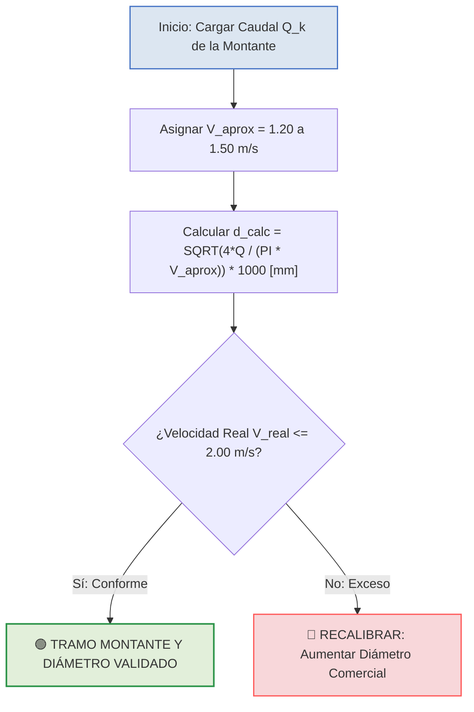

# 1. CRITERIO HIDRÁULICO DE MONTANTES VERTICALES

En el diseño hidrosanitario de edificaciones, las **columnas montantes verticales matrices** deben dimensionarse con una **velocidad aproximada menor** ($V_{\text{aprox}} = 1.20\text{ a }1.50\text{ m/s}$) para proteger la presión residual en el último nivel.

$$
d_{\text{calc}} = \sqrt{\frac{4 \cdot Q}{\pi \cdot V_{\text{aprox}}}} \cdot 1000 \quad [\text{mm}]
$$

## 1.1 ANEXO A: DIAGRAMA LÓGICO DE SELECCIÓN EN MERMAID

### 1.1.1 Secuencia algorítmica validada sin barras de desplazamiento

