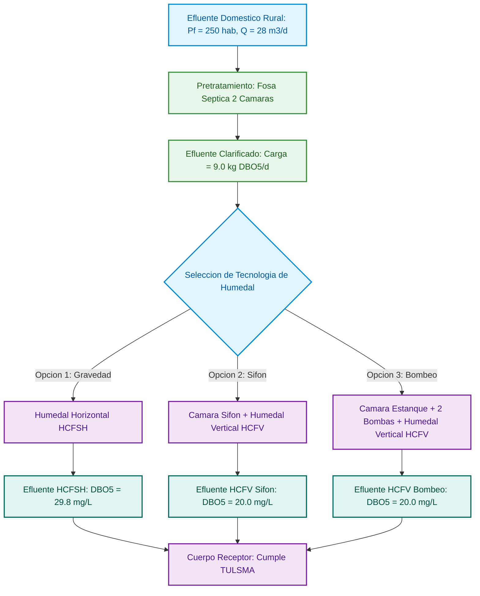

**MEMORIA TÉCNICA DE PRUEBA — SALTOS DE CAPÍTULO (FASE 3)**

Introducción breve del documento. Este bloque precede al primer capítulo y, por la excepción de primera hoja, debe compartir la Hoja 1 con el capítulo «1.».

# 1. Primer capítulo

Texto del primer capítulo, con **negrita** y una fórmula en línea $Q = V \cdot A$.

## 1.1 Caudal de diseño

Contenido del subtítulo 1.1.

---

## 1.2 Velocidades admisibles

Contenido del subtítulo 1.2 (precedido de un separador `---`, que no debe generar salto).

# 2. Segundo capítulo

Este capítulo debe iniciar en una hoja nueva.

## 2.1 Pérdidas de carga

Contenido del subtítulo 2.1.

---

## 2.2 Presiones residuales

Contenido del subtítulo 2.2.

# 3. Tercer capítulo

Este capítulo debe iniciar en una hoja nueva e incluye el diagrama del Anexo A, que no debe quedar roto por el salto.

