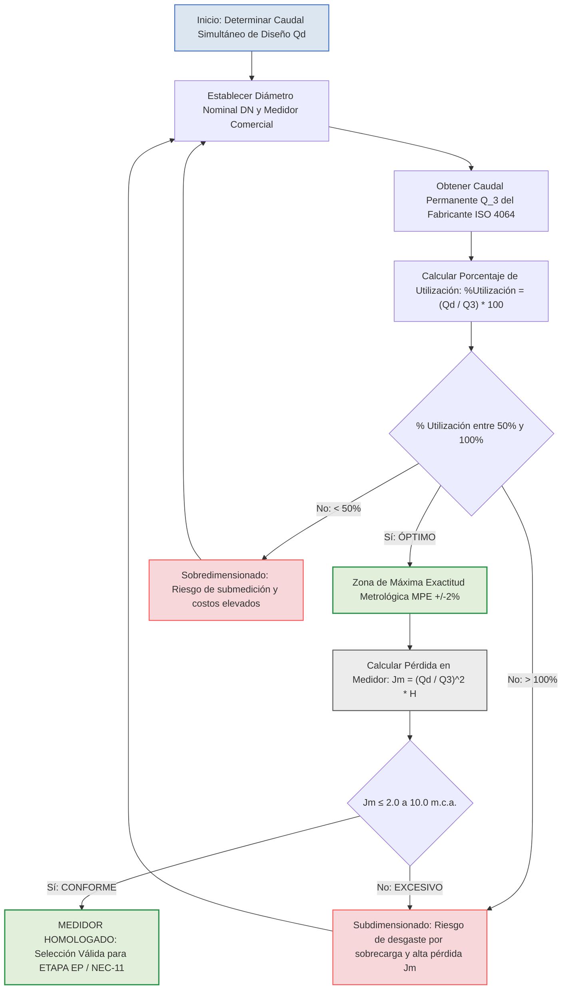

# MEMORIA TÉCNICA Y AUDITORÍA METROLÓGICA: SELECCIÓN Y DIMENSIONAMIENTO DE MEDIDORES DE AGUA POTABLE BAJO LAS NORMAS ISO 4064 Y OIML R 49

En la ingeniería de redes de distribución de agua potable para edificaciones de uso mixto (residencial y comercial), la selección metrológica del contador de agua o medidor representa un procedimiento crítico de diseño. Este proceso garantiza la precisión en la cuantificación de volúmenes consumidos, la eficiencia en el control de pérdidas por fugas, el equilibrio de la carga hidrostática de la red y la protección mecánica contra el desgaste prematuro del instrumento.

A continuación, se desarrolla la memoria de cálculo analítica, el marco normativo de referencia y los resultados de dimensionamiento para el medidor general del **Edificio LEMA** (compuesto por 12 unidades de consumo: 4 locales comerciales en Planta Baja y 8 departamentos residenciales en los niveles elevados), estructurada bajo los estándares de las normas **ISO 4064**, **OIML R 49**, la **NEC-11 (Capítulo 16: NHE Agua)** y los pliegos de control metrológico de **ETAPA EP**.

## 1. MARCO NORMATIVO Y FINALIDAD DE LA SELECCIÓN METROLÓGICA

La selección de contadores de agua no se limita a igualar el diámetro del instrumento con el diámetro de la tubería de acometida. Constituye una evaluación hidráulica y metrológica orientada a satisfacer cinco objetivos fundamentales:

1. Exactitud Metrológica y Facturación Justa: Registrar con absoluta fidelidad el consumo real de cada unidad dentro del margen de Máximo Error Permisible (MPE de $\pm 2%$ en el campo superior de medida), protegiendo tanto al usuario como a la entidad prestadora del servicio (ETAPA EP). **2. Control Activo de Pérdidas:** Disponer de una sensibilidad metrológica adecuada en caudales bajos para detectar fugas continuas, goteos en accesorios o consumos anómalos en la red interna. **3. Cumplimiento de Estándares Internacionales y Nacionales:** Alinear el dimensionamiento con las especificaciones de las normas ISO 4064, OIML R 49 y el numeral 16.5.2.1 de la norma NEC-11.
2. Preservación de la Carga Hidráulica: Asegurar que la pérdida de presión localizada ($J_{\text{m}}$) inducida por la restricción física del contador no reduzca la presión residual en los aparatos sanitarios más desfavorables de la edificación. **5. Durabilidad Mecánica:** Evitar el desgaste prematuro de la turbina o los componentes internos debido a sobrevelocidades por subdimensionamiento, así como impedir la incrustación y falta de registro por sobredimensionamiento.

## 2. CRITERIOS PRINCIPALES DE SELECCIÓN Y PARÁMETROS DE CARACTERIZACIÓN

Cuadro 1: Matriz de Criterios Técnicos para la Selección de Medidores

| Criterio de Selección | Parámetro de Control | Rango / Límite Normativo Admisible | Justificación Metrológica e Hidráulica |
|---|---|---|---|
| Caudal de Diseño ($Q_{d}$) | Caudal Máximo Probable | Simultaneidad Hunter / Bloques | Determina la demanda simultánea máxima estimada para la edificación. |
| Caudal Permanente ($Q_3$) | Caudal Nominal | Referencia principal ISO 4064 | Caudal continuo al cual el medidor opera dentro del MPE sin fatiga. |
| Porcentaje de Utilización | $\frac{Q_{\text{d}$}}{Q_3}$ \times 100$ | 50% a 100% de $Q_3$ | Rango óptimo que sitúa al contador en su zona de máxima exactitud (MPE $\pm 2%$). |
| Pérdida de Carga ($J_{$m$}$) | Caída de Presión Inducida | 2.0 a 10.0 m.c.a. (NEC-11) | Pérdida de carga hidrostática admisible para no afectar la presión de servicio. |
| Clase Metrológica | Precisión de Turbina | Clase C ($R_160$ o superior) | Superior a la Clase B; ofrece mayor sensibilidad de registro en caudales bajos. |
| Rango Dinámico ($R$) | $R = \frac{Q_3}{Q_1}$ | $R \ge 10$ (Estándar R160) | Mide la amplitud de trabajo metrológico exacto del instrumento. |
| Diámetro Nominal (DN) | Dimensión Mecánica | DN 15 (1/2") a DN 25 (1") | Tamaño del cuerpo del medidor compatible con la acometida. |
| Presión de Trabajo (PN) | Resistencia Estática | 0.3 a <10 bar (PN 10 / 16 bar) | Garantiza la integridad física ante picos de presión y golpe de ariete. |
| Tipo de Instalación | Configuración de Red | Medidor General / Banco | Define si el equipo es un contador principal, divisionario o de batería. |

## 3. RELACIONES NORMATIVAS Y FORMULACIÓN DE CAUDALES LÍMITE (ISO 4064 / OIML R 49)  De acuerdo con la norma **ISO 4064**, todo contador de agua se caracteriza por cuatro caudales límite que delimitan sus curvas de error metrológico: - $Q_1$ (Caudal Mínimo / Límite Inferior de Exactitud): Caudal más bajo al cual el contador funciona sin superar el error máximo permisible de $\pm 5%$. - $Q_2$ (Caudal de Transición): Caudal comprendido entre $Q_1$ y $Q_3$ que divide el rango de medición en dos zonas: la zona inferior (error $\pm 5%$) y la zona superior (error $\pm 2%$). - $Q_3$ (Caudal Permanente / Nominal): Caudal más alto al cual el medidor funciona de manera satisfactoria bajo condiciones normales de uso continuo o intermitente. - $Q_4$ (Caudal Máximo o de Sobrecarga): Caudal más alto que el medidor puede soportar durante un período corto de tiempo sin deteriorarse.  Las relaciones matemáticas estandarizadas entre estos cuatro caudales límite se expresan a través de los siguientes modelos analíticos centrados:

3.1 Rango Dinámico Metrológico  $$\frac{Q_3}{Q_1} \ge 10$$ - $Q_3$: Caudal permanente nominal del contador de agua según ISO 4064, expresado en metros cúbicos por hora ($\text{m}^3/\text{h}$). - $Q_1$: Límite inferior de exactitud o caudal mínimo de operación, expresado en metros cúbicos por hora ($\text{m}^3/\text{h}$). - $10$: Límite inferior normativo del rango dinámico adimensional $R$. Para Clase C, este cociente se fija en $R = 160$.

3.2 Relación Normativa de Transición  $$\frac{Q_2}{Q_1} = 1.6$$ - $Q_2$: Caudal de transición que separa los campos inferior y superior de error metrológico, expresado en metros cúbicos por hora ($\text{m}^3/\text{h}$). - $Q_1$: Límite inferior de exactitud del contador, expresado en metros cúbicos por hora ($\text{m}^3/\text{h}$). - $1.6$: Factor de proporcionalidad adimensional estandarizado por ISO 4064 y OIML R 49.

3.3 Relación Normativa de Sobrecarga  $$\frac{Q_4}{Q_3} = 1.25$$ - $Q_4$: Caudal máximo o de sobrecarga soportado en períodos cortos sin deterioro mecánico, expresado en metros cúbicos por hora ($\text{m}^3/\text{h}$). - $Q_3$: Caudal permanente nominal del medidor de agua, expresado en metros cúbicos por hora ($\text{m}^3/\text{h}$). - $1.25$: Factor constante normativo de sobrecarga máxima tolerable (adimensional).

3.4 Criterio de Selección por Porcentaje de Utilización de Capacidad  $$%Utilización = \left( \frac{Q_{d}}{Q_3} \right) \cdot 100$$ - $\text{%Utilización}$: Porcentaje de trabajo del contador de agua respecto a su capacidad permanente nominal (%). - $Q_{\text{d}}$: Caudal simultáneo de diseño o máximo probable del tramo o edificación, expresado en metros cúbicos por hora ($\text{m}^3/\text{h}$). - $Q_3$: Caudal permanente nominal del contador seleccionado según norma ISO 4064, expresado en metros cúbicos por hora ($\text{m}^3/\text{h}$). - $100$: Coeficiente constante de conversión a porcentaje (adimensional).

3.5 Pérdida de Carga Localizada en el Medidor  $$J_{m} = \left( \frac{Q_{d}}{Q_3} \right)^2 \cdot H$$ - $J_{\text{m}}$: Pérdida de carga hidrostática o caída de presión inducida por el medidor, expresada en metros de columna de agua (m.c.a.). - $Q_{\text{d}}$: Caudal simultáneo de diseño o máximo probable que circula por el medidor, expresado en metros cúbicos por hora ($\text{m}^3/\text{h}$). - $Q_3$: Caudal permanente nominal del medidor seleccionado según norma ISO 4064, expresado en metros cúbicos por hora ($\text{m}^3/\text{h}$). - $H$: Pérdida de carga de referencia a caudal permanente nominal $Q_3$, fijada normativamente en 1.0  m.c.a. (equivalente a 0.1  bar).

## 4. RESULTADOS DE CÁLCULO Y SELECCIÓN DEL MEDIDOR GENERAL (EDIFICIO LEMA)  A partir de la caracterización de los consumos individuales de la edificación, se determinaron los caudales simultáneos por unidad tipo y para la totalidad del proyecto:

Cuadro 2: Resumen de Caudales Simultáneos por Unidad y Total Edificación

| Unidad / Nivel de Consumo | Equipamiento Sanitario Considerado | Sumatoria de Pesos $\sum P$ | Caudal Simultáneo $Q_{$d$}$ (L/s) | Caudal Simultáneo $Q_{$d$}$ (m³/h) |
|---|---|---|---|---|
| Local Comercial PB (4 Unidades) | 1 Lavabo + 1 Inodoro con cisterna | 0.8 | 0.2236 L/s | 0.805 m³/h |
| Departamento $P_2$ / $P_3$ (8 Unidades) | 1 Ducha + 1 Inodoro + 1 Lavabo + 1 Lavadora + 1 Fregadero | 3.0 | 0.4330 L/s | 1.559 m³/h |
| Total Edificación (12 Unidades) | 4 Locales PB + 8 Departamentos Residenciales | 27.2 | 1.3038 L/s | 4.694 m³/h |

Cuadro 3: Ficha Técnica del Medidor General Seleccionado (ISO 4064)

| Parámetro Metrológico | Valor Calculado / Seleccionado | Criterio de Verificación Normativa |
|---|---|---|
| Caudal de Diseño ($Q_{$d$}$) | 1.3038 L/s = 4.694 m³/h | Caudal simultáneo máximo probable total del edificio. |
| Diámetro Nominal (DN) | 1" (DN 25) | Compatible con la tubería de acometida general. |
| Caudal Permanente ($Q_3$) | 6.300 m³/h | Capacidad nominal del contador seleccionado según catálogo ISO. |
| Caudal de Sobrecarga ($Q_4$) | 7.875 m³/h | Calculado mediante $Q_4 = 1.25 \cdot $Q_3$ (resistencia a picos). |
| Porcentaje de Utilización | 74.51% | 🟢 RANGO ÓPTIMO (50% a 100%): Operación en zona de máxima exactitud. |
| Pérdida de Carga ($J_{m}$) | 0.56 m.c.a. | 🟢 CONFORME: Muy inferior al rango límite de 2.0 a 10.0 m.c.a. (NEC-11). |
| Clase Metrológica | Clase C (R160) | Rango dinámico ($R=160$) para máxima precisión en caudales bajos. |

### Nota Técnica N.º 6 (Justificación Auditora)

La utilización de capacidad del **74.51%** sitúa al medidor general de **1" (DN 25)** de forma perfecta dentro de la zona de máxima precisión metrológica (MPE $\pm 2%$). Esta condición evita la fatiga de la turbina por sobrevelocidad y mantiene una pérdida de carga sumamente baja de apenas **0.56 m.c.a.**

Este valor de pérdida se encuentra considerablemente por debajo del rango típico de **2.0 a 10.0 m.c.a.** indicado en el numeral 16.5.2.1(b) (5) (k) de la norma **NEC-11**, lo que confirma la holgura del medidor seleccionado, asegurando que la presión remanente del edificio no sufra atenuaciones perjudiciales y garantizando la aprobación inmediata del proyecto ante la empresa pública **ETAPA EP**.

## 5. DIAGRAMA LÓGICO DE SELECCIÓN Y VALIDACIÓN METROLÓGICA

El siguiente flujograma estructura el algoritmo analítico de selección y auditoría de contadores de agua según ISO 4064:

*La caracterización y dimensionamiento del medidor general de ****1" (DN 25 - Clase C / R160)**** aseguran que el ****Edificio LEMA**** disponga de un sistema de medición de agua potable técnicamente irreprochable, con bajas pérdidas de carga y alta fidelidad metrológica, listo para su aprobación por parte de ****ETAPA EP****.*

📊 ¿Deseas que elabore la tabla detallada de selección de micromedidores individuales (divisionarios de 1/2" o DN 15) para los 4 locales comerciales de Planta Baja y los 8 departamentos residenciales?
